# DeepSeek Harness 面试记录 — 2026-11-17 至 2026-11-22

本文按主题整理面试问题、回答和追问。技术结论以实际检查的仓库代码为依据；现有实现、设计建议和未运行的验证分别说明。

## 面试约定

每个原始问题和独有追问均保留；重复的题目提示并入正文解释，同一机制集中说明。各主题保留设计依据、代码职责、流程图和验证限制。

记录最初指定路径为 interviews/2026-11-17.md，后由面试官改为当前文件；本次仅整理 Markdown，没有修改产品代码。原题“（2/2）”标记保留在第 5 题的问题原文中。

## 目录

1. [多模型接入、能力适配与故障降级](#topic-1)
2. [流式响应：解析、性能、取消、恢复与消息版本](#topic-2)
3. [MCP 工具确认、权限与审计](#topic-3)
4. [RAG 引用设计、可信度与排障评测](#topic-4)
5. [模型输出安全、结构化 UI 与 Markdown 排版](#topic-5)
6. [后台任务进度、幂等与恢复](#topic-6)
7. [AI 前端改版的体验评估与实验设计](#topic-7)

## 编号对照与合并范围

| 原编号 | 整理后 | 合并范围 |
| --- | --- | --- |
| 1、10 | 1 | 统一模型接口、能力差异、超时重试与降级；副作用幂等详解移至第 6 题，降级指标移至第 7 题 |
| 2、6 | 2 | 流式解析、取消竞态、断线恢复、批量性能与消息编辑版本 |
| 3 | 3 | MCP 操作确认、授权与审计 |
| 4、8 | 4 | 引用展示、证据版本、RAG 排障与分层评测 |
| 5、7 | 5 | 输出安全、结构化 UI、HTML 隔离与 Markdown 流式排版 |
| 9 | 6 | 后台任务状态、请求和步骤幂等、刷新及服务端重启恢复 |
| 11 | 7 | 体验指标、降级效果、离线回归与线上实验 |

**整理检查：** 原 11 个编号整理为 7 个主题；15 个原始问题、15 个独有追问、全部 131 个不同引用目标、3 段代码摘录和 15 张流程图均保留。重复正文集中说明，同目标代码行合并职责，2 条重复设计依据归入已有同义条目。204 处本地引用的文件与行号、目录锚点、编号、空白和末尾换行检查通过；15 张 Mermaid 图语法解析通过，未做视觉布局验收。本次未修改产品代码，未运行产品测试、性能实验或全仓文档门禁。

## 面试问答

<a id="topic-1"></a>

### 1. 多模型接入、能力适配与故障降级

#### 问题与追问

**问题 1.1：** 你要在 React 应用里做 AI 助手，后端可能调用不同模型。某个模型超时或限流时，前端体验不能卡死。你会怎么设计前后端边界、重试和降级？

**考察点：** 模型供应商解耦、超时控制、重试策略、错误状态设计。

**追问 1.1：** 怎样避免用户重试后重复执行了有副作用的工具操作？

**问题 1.2：** 前端接入多个模型供应商时，怎样设计统一调用层而不把差异藏得太深？

**考察点：** 接口适配、能力差异、错误语义。

**追问 1.2：** 当备用模型不支持原模型的工具调用格式时，如何降级？

**问题 1.3：** 模型或工具服务变慢、报错时，AI 功能该怎样优雅降级？

**考察点：** 超时、重试策略、备用路径、用户体验与可观测性。

**追问 1.3：** 什么情况下切换备用模型反而会让体验更差？

**回答要点：** 模型调用与密钥放后端，统一消息、事件和错误语义，显式声明模型能力。恢复策略受次数、总时间和成本预算约束；无法完成原任务时明确降级。副作用幂等的完整方案集中在第 6 题。

#### 前后端边界

React 只访问自己的后端，提交消息、业务请求标识和允许的模型偏好，订阅流式事件并提供取消操作。供应商密钥、鉴权、配额、模型路由和工具执行都由后端管理；后端校验模型选择，不能让客户端任意指定供应商地址或绕过权限。通过 SSE 或 WebSocket 向前端发送统一事件，使组件不依赖供应商 SDK。

仓库的适配层可作为依据：[LlmAdapter](../packages/llm/llm/src/index.ts#L217) 注册供应商路由，[stream](../packages/llm/llm/src/index.ts#L312) 统一接收 GenerateOptions、返回 AsyncIterable<StreamChunk>，并要求实现遵守取消信号。错误由 [LlmFailure](../packages/llm/llm/src/types.ts#L47) 统一表示，包含 code、status、providerRetryAfterMs 和供应商 requestId。DeepSeek 的 [resolveDeepSeekApiKey](../packages/llm/llm-deepseek/src/credential.ts#L15) 从凭据服务或启动环境读取密钥，这是模型运行侧的职责。

#### 统一消息、能力声明与诊断信息

统一接口定义共同消息、块增量、结束原因和错误字段，能力声明作为调用前置条件。适配层不能静默删除不支持的图片、工具或 JSON Schema，也不能把未知能力默认成支持。

仓库的 [GenerateOptions](../packages/llm/llm/src/types.ts#L564) 统一 provider、model、messages、tools、signal 等输入，[StreamChunk](../packages/llm/llm/src/types.ts#L496) 区分 text-delta、reasoning-delta、tool-call-delta、usage 和 finish；index 用于关联交错的内容块，工具参数在流式阶段保留为 JSON 字符串片段，不能拿半段参数执行工具。[LlmFailure](../packages/llm/llm/src/types.ts#L47) 保留稳定错误码、HTTP 状态、Retry-After 和供应商 requestId，因此前端可以用统一错误语义给出操作建议，后端仍能定位原始请求。

能力应按“供应商路由 + 精确模型 + 配置版本”解析。建议显式描述输入模态、工具调用及并行工具、支持的工具 Schema 范围、结构化输出模式、上下文与输出上限，并区分支持、不支持、未知。参数不支持时明确拒绝或展示降级选项，不能假装生效；供应商特有设置放进有命名和校验的扩展字段，避免让任意参数穿透后端。

当前 [LlmModelInfo](../packages/llm/llm/src/types.ts#L369) 已有 inputModalities，字段缺失表示未知；[LlmResolvedModelInfo](../packages/llm/llm/src/types.ts#L454) 还有上下文、输出上限、reasoning、systemPromptUpdate 和 toolUpdate。toolUpdate 表达的是对话过程中工具声明的更新方式，不等于“是否支持工具调用”的完整声明。当前类型没有上述全部能力矩阵，完整的工具与结构化输出兼容性检查仍是建议。[prepareCall](../packages/llm/llm/src/index.ts#L305) 提供将精确模型元数据和 stream 入口绑定到同一适配器代次的接口；动态适配器需据此避免配置切换后用旧能力判断新端点。

诊断信息分两层保留：界面显示稳定错误分类、可执行建议和支持编号；受限服务端记录脱敏后的供应商错误详情与 cause、requestId、traceId。不能把原始响应中的密钥、用户输入或内部端点原样展示。重试和总超时由统一编排层负责，协议适配器负责正确转换和取消传递，避免各层重复重试；具体策略见本题的超时重试与降级部分。

#### 追问：备用模型的工具调用格式不兼容

先区分“格式不同”和“能力不存在”。如果备用模型具备等价工具能力，只是 wire 格式不同，由适配器将规范化工具定义、调用 ID、完整参数和工具结果转换为目标格式；必须保持调用与结果的配对、Schema 含义以及已完成操作的幂等标识，并通过固定用例验证转换。供应商私有 replayState 不能跨供应商直接照搬；[ReplayEnvelope](../packages/llm/llm/src/types.ts#L474) 明确其为适配器私有元数据。

如果备用模型不支持所需工具能力，或无法无损表达参数约束，就不能把工具要求塞进普通提示词后将自由文本当成可执行调用。可改选兼容模型，或在产品允许时降级成明确标注的文字解释、基础搜索或人工办理；用户原本要求执行的业务动作必须保持“未完成”。已成功的工具结果可以在权限允许且语义兼容时继续作为上下文使用，但不能重跑已完成步骤；结果未知先对账。确需新的有副作用操作时，仍走原有参数校验、鉴权与确认流程。

#### 超时与重试

我会设置单次请求超时、流式空闲超时，以及跨重试和备用模型的总耗时预算。持续收到 token 只能重置空闲计时，不能无限延长总预算。取消信号需要传到实际网络请求；只用 Promise.race 让前端结束等待，不能证明后端请求或工具已停止。用户取消不进入自动重试，工具取消也不意味着外部副作用已经回滚。

仓库的 [DeepSeek generate](../packages/llm/llm-deepseek/src/adapter.ts#L65) 合并取消信号，使用 idleWatchdog，将空闲超时映射为 TIMEOUT、用户取消映射为 ABORTED，并在退出时触发 abort。这里直接支持的是取消和流式空闲超时；上述跨模型总预算是本题的设计建议。

重试由后端一个层级统一负责，避免前端、网关和 SDK 各自重试导致调用次数相乘。只重试限流、暂时性服务故障和可恢复的传输超时；鉴权错误、参数错误或明确配额耗尽应直接给出处理方式。采用有上限的指数退避与随机抖动，优先遵守有效的 Retry-After；等待时间超过任务预算时，结束或按策略降级，不能提前请求。

仓库的 [resolveRetryPolicy 默认值](../packages/llm/llm/src/retry-policy.ts#L15) 是首次请求后最多重试 5 次，初始等待 500 ms、单次等待上限 10 秒、抖动比例 0.1；默认可重试代码包括 EMPTY_RESPONSE、RATE_LIMIT、SERVER、TIMEOUT、TRANSPORT。[localDelay](../packages/llm/llm-retry/src/index.ts#L60) 实现指数退避和抖动，[recover](../packages/llm/llm-retry/src/index.ts#L213) 检查错误类型、重试次数和 Retry-After。在 normal 模式下，供应商要求的等待超过 maxDelayMs 时交给后续恢复处理，不会缩短等待后继续重试。

需要指出仓库还支持 [always 模式](../packages/llm/llm/src/retry-policy.ts#L49)，它没有次数上限。面向本题的交互式助手，我会使用 normal 模式并加总预算，不能因为仓库有可选的无限重试，就把它当作前端体验保障。

#### 工具超时与业务错误

超时应分别定位到排队、首个有效输出、流式空闲或工具执行；每次重试前检查剩余总时间与调用预算，不启动注定无法在预算内完成的新尝试。

鉴权、参数、权限或订单状态拒绝应直接说明原因，不能靠换模型解决；工具结果未知时先核实外部状态。

工具超时也不等于强制停止。[timeout-policy](../packages/guard/timeout-policy/src/index.ts#L55) 将 deadline 信号传入工具执行并等待下游返回；工具必须合作响应取消，外部资源也需要自行清理。不能把这个机制描述成可以强行终止任意不响应信号的工具，更不能把超时映射成“业务操作肯定未执行”。

#### 降级和 React 状态

重试预算耗尽后，只能在上述能力与权限要求下选择备用路径，切换次数和费用仍受总预算约束。全部路径不可用时保留输入和已有结果，结束等待并说明下一步操作，不能伪装成生成成功。

若旧模型已经输出部分内容，事件应携带 attemptId，让前端把新尝试显示为重新生成，不能把两个模型的文本直接拼接。只重试尚未成功的模型步骤，已完成的工具结果继续保留。仓库在 [agent/request-error 处理](../packages/core/agent-loop/src/agent.ts#L548) 中决定是否重试，并在成功生成消息之后才进入 [工具执行](../packages/core/agent-loop/src/agent.ts#L592)。本次检查没有确认现成的通用跨供应商自动降级策略；备用模型选择是需要增加的恢复策略，不能将 request-error 扩展点说成已经实现自动切换。

React 使用明确的状态，例如 submitting、streaming、retrying、switching、succeeded、failed、cancelled。后端退避期间显示重试次数和下次尝试时间，保留取消入口；最终失败必须结束 loading，允许安全重试。连接断开只代表订阅中断，前端先凭任务 ID 查询状态或续订事件，不自动重放创建任务的请求。旧 attempt 的迟到事件也不能覆盖新状态。

仓库会先记录 [llm/retry，再等待并记录 llm/retry-started](../packages/llm/llm-retry/src/index.ts#L185)；前端的 [retryDefinition](../packages/client/ui-chat/src/client/conversation-nodes/retry.ts#L40) 将它们转换成 scheduled、started、cancelled 状态。[turnErrorDefinition](../packages/client/ui-chat/src/client/conversation-nodes/turn-error.ts#L74) 单独展示最终错误，已有重试记录不会遮掉终止失败。这支持前端由服务端事件驱动的设计，但不代表上述所有建议状态都已实现。

#### 基础搜索、缓存与人工路径

如果模型生成失败但检索仍可用，可以展示原始检索结果和来源，明确说明尚未生成总结；若某个工具失败，可保留已验证的步骤结果，标出未完成步骤，并提供安全的人工入口。缓存结果需要展示生成时间或版本，并重新检查用户权限。基础搜索、缓存和备用模型都可能依赖同一个故障服务，只有确认依赖可用才算有效替代路径。

用户点击重试时应明确是重新观察已有任务、重试模型步骤，还是发起新的业务意图。降级路径还需限制并发和切换次数；自动供应商选择、断路器与基础搜索降级并非当前重试展示代码已经提供的通用能力。

#### 追问：备用模型何时会更差

| 情况 | 为什么更差 | 处理原则 |
| --- | --- | --- |
| 主模型已经消耗大部分总预算 | 备用模型重新排队和处理上下文，用户等待更久 | 检查剩余时间，预算不足时及时失败或给检索结果 |
| 备用模型缺少工具、图片、结构化输出或上下文能力 | 看似有答案，实际无法完成用户任务 | 路由前检查必要能力和数据格式要求 |
| 主模型已输出半段回答 | 新旧输出直接拼接会重复或互相矛盾 | 新建 attempt，明确重新生成或保留原中断版本 |
| 前一步工具可能已经成功 | 重跑 Agent 可能重复退款、发信或取消订单 | 复用已知结果，未知结果先对账，保持业务幂等键 |
| 两个模型共享网关、配额或基础设施 | 切换仍然失败，还放大请求和限流 | 判断共同依赖，统一重试预算与并发限制 |
| 失败原因是权限、非法输入或业务拒绝 | 换模型不能修复，也可能诱导绕过约束 | 修正输入或权限，不将其当作模型可用性故障 |
| 备用供应商的数据处理范围不允许该内容 | 可用性提高却违反数据访问与处理要求 | 只在已授权且兼容的供应商集合内切换 |
| 备用模型质量较低或费用显著更高 | 用户可能得到更快但错误的答案，或超出成本预算 | 预先评测质量与成本，必要时展示能力降低 |

切换必须保持对话上下文和工具结果的语义，并做供应商事件格式转换；不能只替换 model 字符串。上述统一适配与重试代码没有证明已有通用跨供应商自动切换实现。

#### 追问：避免重复执行有副作用的工具

没有收到成功响应不代表操作失败。请求重发返回原任务，工具重试复用稳定 operationId；成功则复用结果，执行中则查询，未知则先对账。完整的请求层／工具层方案、退款和崩溃示例、代码依据统一见[第 6 题：幂等与恢复](#topic-6)，不在模型重试处重复实现。

#### 设计依据与取舍

| 问题或约束 | 设计选择 | 原因与限制 |
| --- | --- | --- |
| 供应商协议、密钥和错误类型各异 | 后端适配器统一请求、输出和失败分类 | React 不绑定供应商；是否重试由业务策略决定，不由错误文案猜测 |
| 网络故障可能暂时恢复，也可能持续 | 有上限的退避、抖动、单次超时和总预算 | 防止请求风暴和无限等待；流式空闲超时不等于任务总超时 |
| 重试失败后需要继续服务 | 在总预算内选择能力兼容的备用模型 | 不承诺所有模型可互换；当前只确认恢复扩展点，没有确认通用自动切换 |
| 前端断线不代表任务失败 | 恢复订阅或查询原任务，不重建业务任务 | 防止模型步骤和工具操作被整体重放 |
| 外部操作可能成功，但响应丢失 | 稳定 operationId、下游幂等和结果核实 | 工具调用日志提供线索，不能单独提供业务 exactly-once |
| 模型与工具失败语义不同 | 按可恢复性和副作用状态分类 | 业务拒绝与结果未知不能直接重跑 |
| 备用路径可能同样不可用或能力不足 | 检查依赖、能力、权限、费用与剩余预算 | 切换不是默认正确的恢复动作 |
| 技术成功掩盖业务失败 | 同时统计降级结果与原始目标完成率 | 200、输出文本或展示搜索结果都不自动等于任务成功 |

##### 统一调用层如何显式保留供应商差异：设计与代码依据

| 设计依据与取舍 | 代码定位 | 现有能力或限制 |
| --- | --- | --- |
| 统一共同语义，避免组件适配每家供应商 | [GenerateOptions / StreamChunk](../packages/llm/llm/src/types.ts#L496) | 统一消息和块事件；工具增量不是可执行参数 |
| 能力在调用前显式检查 | [LlmResolvedModelInfo](../packages/llm/llm/src/types.ts#L454) | 已有部分元数据，完整能力矩阵仍需设计 |
| 配置变化不能拆散能力判断与调用目标 | [prepareCall](../packages/llm/llm/src/index.ts#L305) | 接口支持绑定同一适配器代次 |
| 统一错误仍保留可诊断信息 | [LlmFailure](../packages/llm/llm/src/types.ts#L47) | 状态、等待时间和 requestId 不必被压成一句失败文案 |

#### 涉及代码与职责

| 代码入口 | 输入与输出 | 职责与限制 |
| --- | --- | --- |
| [LlmAdapter.stream](../packages/llm/llm/src/index.ts#L312) | GenerateOptions → AsyncIterable<StreamChunk> | 统一供应商流式调用，并要求遵守 signal |
| [DeepSeek generate](../packages/llm/llm-deepseek/src/adapter.ts#L65) | 请求、连接配置与取消信号 → 模型流或分类错误 | 合并 signal、检测空闲并在退出时取消；区分空闲超时、主动取消和传输错误 |
| [recover / localDelay](../packages/llm/llm-retry/src/index.ts#L191) | 失败和供应商策略 → retry 或后续处理 | 决定是否重试及等待多久；localDelay 位于同文件第 60 行 |
| [Agent Loop 请求结算](../packages/core/agent-loop/src/agent.ts#L548) | 模型完成原因 → 重试、异常或工具执行 | 重试模型请求，不直接执行失败尝试中的工具调用 |
| [retryDefinition](../packages/client/ui-chat/src/client/conversation-nodes/retry.ts#L40) | 会话重试事件 → 前端状态节点 | 展示等待、已开始和取消的重试；最终错误另由正文链接的 turnErrorDefinition 展示 |
| [BatchSettlement / repair](../packages/core/tools/src/batch.ts#L243) | 工具开始与结果 → 关联事件 | 通过 callId 关联记录；结果未知的恢复语义详见第 6 题 repair 引用 |
| [resolveRetryPolicy](../packages/llm/llm/src/retry-policy.ts#L15) | 策略配置 → 重试约束 | normal 与 always 的不同上限 |
| [recover](../packages/llm/llm-retry/src/index.ts#L213) | 模型错误与计数 → 重试或委托后续处理 | 可重试类型、次数、Retry-After |
| [timeout-policy](../packages/guard/timeout-policy/src/index.ts#L55) | 工具执行 → 带 deadline 信号的执行 | 合作式取消，不保证强制停止外部操作 |
| [repair](../packages/core/session/src/repair.ts#L14) | 未完成工具记录 → 恢复语义 | 区分未开始和结果未知，防止盲目重试 |

#### 流程图

##### 图 1.1：建议的能力校验与路由

下图是基于现有统一接口提出的路由设计；完整能力校验和备用路径选择不是已验证的现成功能。

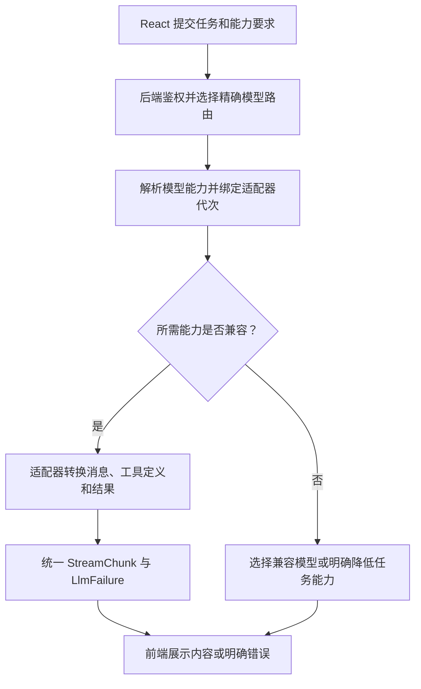

##### 图 1.2：现有模型请求恢复

下图聚焦已有的模型请求恢复流程，省略请求准备和消息组装。自动切换供应商、业务幂等和跨模型总预算不在这条已确认流程中。

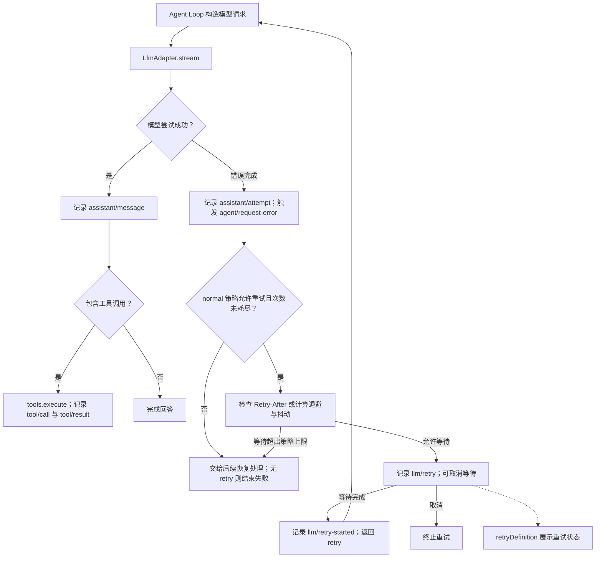

追问的建议恢复路径是：用户重试 → 查原业务 operationId → 已成功则复用结果 → 执行中则等待或查询 → 结果未知则对账 → 只有确认可安全执行时才继续。它不能简化为“超时 → 再调用一次工具”。

##### 图 1.3：现有错误恢复与建议降级

上半部分为仓库现有重试和展示链路；下半部分为预算耗尽后的建议决策，当前没有据此确认自动跨模型降级已经实现。

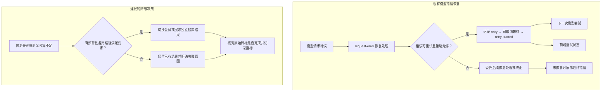

#### 验证记录与实现限制

此前已静态检查上述实现及 [部分失败流不执行工具的测试](../packages/llm/llm-retry/tests/retry.spec.ts#L292)、[有上限退避测试](../packages/llm/llm-retry/tests/retry.spec.ts#L341)。此前尝试执行 `pnpm exec vitest run packages/llm/llm-retry/tests/retry.spec.ts -t 'leaves partial failed chunks|applies bounded exponential jitter|uses a bounded provider Retry-After|delegates non-transient failures|lets turn cancellation win'`，但 pnpm 自动进入工作区依赖安装并遇到包源 ECONNRESET；已停止该进程，未取得测试结果。本轮结论来自静态分析，未调用真实模型或外部业务服务。面试记录的本地引用目标、引用行号及空白格式已检查。

未进行跨供应商格式转换、限流故障注入或备用模型实测。完整能力矩阵、总预算、自动降级、断路器与业务幂等仍是设计建议；不能由已有恢复扩展点推断这些能力已完成。

<a id="topic-2"></a>

### 2. 流式响应：解析、性能、取消、恢复与消息版本

#### 问题与追问

**问题 2.1：** 聊天回答采用流式输出。用户在回答到一半时点击“停止”，紧接着又发出新问题。你如何避免旧请求继续更新界面，或覆盖新回答？

**考察点：** 流式生命周期、取消请求、并发状态管理。

**追问 2.1：** 如果取消信号发出后，服务端仍返回了最后几个数据块，前端怎么处理？

**问题 2.2：** 用户编辑了已发送的问题并重新生成回答，前端怎样处理旧回答和新回答？

**考察点：** 请求生命周期、竞态处理、消息版本。

**追问 2.2：** 如果服务端不支持取消请求，前端还能怎样保证界面正确？

**问题 2.3：** 前端如何处理 LLM 的流式响应，做到逐字展示、取消生成，并在断线后恢复？

**考察点：** SSE／ReadableStream、增量解析、AbortController、重连与状态管理。

**追问 2.3：** 用户快速连续发送两条消息时，如何避免旧响应覆盖新响应？

**问题 2.4：** 模型输出很长，前端如何实现“边生成边展示”，同时保持页面不卡顿？

**考察点：** 流式读取、批量更新、渲染性能。

**追问 2.4：** 如何避免批量更新让用户感觉输出不够及时？

**回答要点：** 将协议解析、数据保存、展示更新和执行生命周期分开：完整事件才能进入状态；按消息、尝试和版本接收更新；取消同时撤销展示资格与释放资源；断线恢复观察已有任务，而非重新执行它。长输出以有界批量和局部渲染减少开销。

#### 先解析完整事件，再做增量展示

网络 chunk、UTF-8 字符、SSE 事件和模型 token 是不同单位。一块数据可能只有半个中文字符，也可能包含多个事件；一个 JSON 可能跨多次读取。不能对每个 chunk 直接 JSON.parse，也不能仅按本次读取结果 split 换行后丢掉尾部。

使用 fetch 获取 ReadableStream 时，我会先用流式 UTF-8 解码器处理跨块字符，再用符合 SSE 协议的解析器处理事件边界、多个 data 行和注释，最后对完整事件做 JSON 解析及事件字段校验。若使用原生 EventSource，SSE 分帧由浏览器负责，业务仍要校验 data；具体选型取决于接口的方法、认证和取消需求。连通性与业务成功分开处理：只有协议规定的完成事件才能结束生成，不能把意外 EOF 当成回答完成。

仓库的 [parseSse](../packages/llm/llm-deepseek/src/sse.ts#L13) 正是“解码 → SSE 分帧 → JSON 解析”的顺序，核心表达式为：

```ts
body
  .pipeThrough(new TextDecoderStream())
  .pipeThrough(new EventSourceParserStream({ onComment: activity }))
```

后续代码对 frame.data 解析 JSON，检查事件类型是否一致，将不合法响应映射为 MALFORMED_RESPONSE。这里是后端读取 DeepSeek 的供应商流；浏览器会话使用下面的 Remote 流，不能把两条链路说成同一个 SSE 接口。

展示层维护每条消息的累计文本，按一帧或小批次更新 React，避免每个字符触发一次昂贵的 Markdown 重渲染。所谓“逐字”通常是增量可见；若产品确实需要打字动画，可在已收到的文本上调度显示，并按用户可见字符处理组合字符和 emoji。收到数据的进度、动画显示的进度和消息完成状态应分开；取消或切换消息时也要清理动画队列。

#### 长输出的批量更新与局部渲染

我会将“接收并保存数据”和“通知 React 展示”解耦：协议解析及时消费完整事件，按当前消息和 attempt 暂存增量，只合并 UI 通知而不丢 token。展示时批量应用累积文本，让只有正在变化的消息或块订阅更新；对已完成消息保持稳定 key、数据引用和组件 props，避免每次遍历并重解析全部历史。

仓库 [ChatFlow](../packages/client/ui-chat/src/client/chat/ChatFlow.tsx#L25) 使用稳定节点 key 分发消息，[ChatNodeSeat](../packages/client/ui-chat/src/client/chat/ChatNodeSeat.tsx#L50) 按 nodeKey 订阅并使用 memo；[MarkdownText](../packages/client/ui-primitives/src/markdown/MarkdownText.tsx#L69) 复用冻结块。但 memo 本身不是性能保证：父级频繁创建新对象、全量订阅或上下文变化仍可能使大量节点更新，应以 React Profiler 和浏览器性能轨迹确认更新范围。

需要精确区分通知器提供的方法和真实调用链。[Notifier.markFrameDirty](../packages/api/session-controller/src/client/sessions/notifier.ts#L39) 确实能按 requestAnimationFrame 合并通知；[markDirty](../packages/api/session-controller/src/client/sessions/notifier.ts#L30) 则使用微任务。当前 [publishAssistantEntry](../packages/api/session-controller/src/client/sessions/session.ts#L803) 调用的是 markDirty；本轮在该客户端目录中未找到 markFrameDirty 的调用。因此，按帧批量是可借鉴的现有方法和建议接入方式，不能宣称当前所有流式 UI 更新已经限制到每帧一次。

长对话可采用历史分页和虚拟列表，但需要动态测量消息高度、维护滚动锚点并保留适量 overscan；用户正在读历史时不要每个增量都强制滚到底部。虚拟化还要考虑文本选择、查找、引用跳转和辅助技术。仓库 [TurnNavigator](../packages/client/ui-chat/src/client/chat/TurnNavigator.tsx#L110) 虚拟化的是回合导航条，而 [ChatFlow 的 entries.map](../packages/client/ui-chat/src/client/chat/ChatFlow.tsx#L52) 仍映射传入条目，不能用导航条虚拟化来证明聊天正文已全部虚拟化。

虚拟列表主要减少屏幕外历史消息的 DOM，无法单独解决“当前一条回答就非常巨大”。这时还要限制每批解析工作，缓存稳定块和高亮行，必要时对超长代码折叠或分块展示；对可序列化的重计算可以考虑 Worker。requestAnimationFrame 或 React 调度优先级只改变执行时机，不会把同步解析移出主线程，也不会自动降低其计算量。

#### 追问：批量更新如何保持及时

采用“首段尽快显示、后续有界批量、结束立即排空”的策略。首个有效文本到达后争取下一可显示帧提交，不等待固定 token 数；后续按帧或经测量的小时间窗口合并，并以最老待显示内容的等待时间约束批量，低速输出也不会一直凑不够一批。终态到来先提交有效缓冲再标记完成；取消、切换版本则只处理仍有效版本的缓冲，并禁止旧计时器提交。

高吞吐时增大批次可以减少提交次数，但每次解析仍须在可接受的主线程预算内。后台页面的动画帧和计时器都可能被节流，因此恢复可见时应从最新累计状态刷新，而不是播放全部旧动画；缓冲也要有容量策略，必要时借助后端快照／重放，不能无界占内存或丢弃内容装作成功。具体时间阈值应根据目标设备和长文本回放测试确定，不把固定毫秒数当成通用标准。

我会分别量“收到首个文本到首次可见”的延迟、批次间最大可见停顿、单次解析／提交耗时、长任务、输入响应和滚动稳定性。只看平均 FPS 或平均提交次数不够：用户最容易感知的是首段等待、长时间不更新和输入卡顿。完整评估见[第 7 题](#topic-7)。

#### 停止时先让旧请求失效

每个会话维护当前请求上下文，包含 requestId、attemptId、messageId、控制器和生命周期状态；重试或切换模型产生新的 attemptId，新的用户问题产生新的 requestId。订阅重建还需要 generation，不能把仅在一次服务端生命周期内唯一的 attemptId 当作跨重启永久唯一标识。

点击停止时，先同步通过 ref 或外部 store 将旧请求标为不再接收增量，保留已经展示的正文，并标记“已停止显示”或“正在停止”。随后调用旧请求自己的 controller.abort()，请求后端取消，并清理该请求的 reader、监听器、订阅、定时器和待刷新的缓冲区。不能等待取消接口返回后才让旧请求失效，否则这段时间仍可能接受旧数据。新问题使用新的控制器和请求标识；已 abort 的控制器不能复用。

如果使用会话级共享 WebSocket，只取消旧请求的订阅和处理器，不能关闭新问题仍需使用的共享连接。清理逻辑必须绑定创建它的请求，不能从一个可变的全局 ref 里取出新控制器再 abort。组件卸载时也遵循同样规则。

仓库的 [Session.dispose](../packages/api/session-controller/src/client/sessions/session.ts#L683) 会先增加 openGeneration、解绑旧事件源，再等待旧订阅释放；[doOpen](../packages/api/session-controller/src/client/sessions/session.ts#L704) 在发布、异步完成、错误和 finally 路径上校验代次。这是旧异步任务不能修改新状态的代码依据，但它管理的是订阅生命周期，不等于点击停止时已实现了立即冻结消息。

取消 reader 后释放其锁，异步清理放在 finally 并处理清理异常。只做身份过滤会留下仍在消耗资源的请求，只做 abort 则无法阻止已排队回调；两者需要同时实施。

#### 所有写入都校验所属请求

每个 chunk、完成事件、错误事件和 finally 清理都携带所属请求标识。写入前检查它是否属于当前有效请求、对应消息是否仍允许流式更新。使用 reducer 或函数式更新处理 token 追加，避免闭包读取旧文本；reducer 应再次检查事件标识和消息状态，不能认为函数式更新本身就会过滤旧请求。

特别容易遗漏的是旧请求的 finally：如果它无条件执行 setLoading(false) 或清空当前 controller，就可能关闭新问题的 loading 或取消能力。它只能清理自己持有的资源，只有仍持有当前请求时才修改共享状态。使用 requestAnimationFrame、节流或批量合并 token 时，也要取消旧任务，并在真正提交缓冲内容时再检查一次标识。

仓库的 [AssistantStreamAttempt](../packages/core/agent-loop/src/assistant-stream.ts#L49) 为 start、chunk、end 帧附上 attemptId 和 revision，并为 chunk 编号。客户端 [ClientAssistantStream.acceptFrame](../packages/api/session-controller/src/client/sessions/assistant-stream.ts#L129) 在 attemptId 不匹配时忽略 chunk 和 end；已知尝试的 index 不连续时要求重新获取基线，而不是直接拼接。上层 [transport](../packages/api/session-controller/src/client/transport.ts#L208) 还校验流 revision 连续性。因此应在各层已有顺序语义内处理异常，不能声称所有乱序帧都会被静默丢弃。

#### 服务端取消与新问题的顺序

前端停止显示与服务端实际停止是两个状态。取消接口返回 accepted，只表示服务端接收了请求，不能据此宣称生成、工具执行和资源清理都已结束。后端应把取消信号传播到模型请求和流式读取，取消后不再发布旧生成的增量，并正确结束旧轮次；需要等待旧轮次退出的同一会话，可以先接收新问题并排队。

仓库的 [Agent.cancel](../packages/core/agent-loop/src/agent.ts#L192) 触发当前控制器的 abort；[流式消费循环](../packages/core/agent-loop/src/agent.ts#L494) 在发布每个 chunk 前检查 throwIfAborted，取消时保留安全的正文前缀并记录 interrupted: true。[send 和 wakeDriver](../packages/core/agent-loop/src/agent.ts#L171) 会把取消后到达的新输入归入下一轮，在旧执行退出后重新唤醒，避免新消息落入已取消的执行。

还有一种跨请求竞态：停止 A 的命令可能比启动 B 更晚到达服务端。我会让取消命令携带目标 runId 或预期执行代次，由后端只取消 A；如果接口只能按会话取消，则必须保证停止与新提交的服务端处理顺序，不能同时发出后假定网络会保序。当前仓库的 [客户端 cancel](../packages/api/session-controller/src/client/sessions/session.ts#L377) 只传 sessionId，[服务端 cancel](../packages/api/session-controller/src/commands.ts#L526) 取消该会话当前 Agent 并返回 accepted。这些代码不能证明已具备按 runId 防止误取消新任务的保障；该保障是本题的设计建议。

#### 追问：取消后仍收到最后几个数据块

直接拒绝这些旧请求的展示更新，不把它们追加到旧消息，也不转交给新回答。判断依据是所属请求已失效或消息已停止，而不是等待网络层报 AbortError。传输缓冲区、已排队的回调和异步解析都可能让数据在取消后继续到达。

例如顺序是“A 输出 → 停止 A → 启动 B → A 的迟到 chunk → A 的 finally → B 的 chunk”：A 的 chunk 因请求已失效被忽略；A 的 finally 只清理 A；B 的 chunk 正常更新 B。迟到的 A 成功或错误事件同样不能把消息状态改回完成，也不能影响 B 的 loading。与之不同，服务端的取消确认、用量和持久化结果可以按 A 的身份进入审计或历史存储，但不能恢复 A 的实时生成或覆盖 B。

仅比较 requestId 还不够：用户停止后没有立即发新问题时，旧 ID 可能仍相同，所以必须同时校验 stopped/cancelled 等状态，或者直接撤销它的有效身份。仓库当前的 ClientAssistantStream 依赖 activeAttempt 判断，而客户端 cancel 本身没有清除它；因此不能仅凭 attemptId 过滤代码声称“点击停止瞬间之后，旧流绝不再更新”。严格满足本题还需要本地停止状态参与展示校验。

#### 追问：连续发送两条消息的竞态

首先定义产品语义：允许并行、排队，还是新消息替换旧生成。并行时按 messageId 分别维护状态，不能用全局 currentRequest 丢掉另一条有效消息；同一会话的串行 Agent 则要明确入队规则。若采用替换策略，发送 B 时先使 A 的本地 generation 失效，再取消 A，并为 B 建立新的消息和尝试。

身份检查、旧 finally 和晚到取消命令的处理统一采用上面的规则。并行模式按消息维护多个有效 attempt；替换模式撤销旧 attempt，不能把两种接收规则混用。

#### 断线恢复取决于服务端保存了什么

后端需要提供任务或会话 ID、单调事件序号，以及可衔接的快照和增量事件。客户端记录最后应用的游标，重连后去重、检测缺口，并从服务端补齐或用新快照替换本地基线。快照与订阅必须具有一致的切分位置，否则“先查询快照，再开始监听”之间会漏事件。仅有 SSE 的 event id 或自动重连，并不等于服务端实现了重放。

本仓库有可核对的实现：[SessionEventStream](../packages/api/session-controller/src/client/transport.ts#L138) 把会话记录的 seq 交给 RemoteJournalStream 管理；[follow](../packages/api/session-controller/src/client/transport.ts#L173) 的首帧携带快照与 assistantStream 基线，并检查后续 assistant-stream revision。[RemoteJournalStream](../packages/api/gateway/src/client/journal-stream.ts#L83) 重连期间保留已展示窗口，[replaceFromOpening](../packages/api/gateway/src/client/journal-stream.ts#L287) 使用新快照替换窗口，[acceptEntry](../packages/api/gateway/src/client/journal-stream.ts#L304) 丢弃已应用事件、检测重叠和缺口并发起修复。它不是无条件从旧文本后追加新 token。

正在生成的临时文本和持久化会话记录也不能混为一谈。[assistant-stream.replace](../packages/api/session-controller/src/client/sessions/assistant-stream.ts#L58) 用新的活动尝试与前缀建立基线；结束时再与持久化消息衔接。服务端没有重放或当前前缀能力时，应提示“连接中断，当前结果可能不完整”，先查询任务状态；确需重新生成则创建明确的新尝试，保留原消息为中断状态，不能宣称从断点继续，更不能因此自动重放工具操作。

#### 编辑已发送问题：消息版本与历史分支

我会保留原问题和回答的版本记录，为修改后的问题创建新 revision，并将新回答明确绑定到这个 revision。编辑历史消息会改变后续对话的上下文，因此不仅是清空一个回答气泡：旧回答以及依赖它的后续对话应保留在旧分支或标记过期，不能混入新分支的模型上下文。

建议数据至少区分 conversationId／branchId、messageId、inputRevision、answerId 和 attemptId：revision 表示用户编辑，attempt 表示同一输入版本的一次生成，传输重连则不应创建新的业务 attempt。再次生成相同输入只新增回答尝试；编辑输入则新增输入版本。提交编辑时由后端验证 expectedRevision 并原子接受，冲突则提示重新同步，避免两个标签页彼此覆盖。

沿用前述取消和身份准入流程，为新版本创建独立输出容器，并额外清理该版本的解析器、高亮缓存和引用加载任务。旧回答可折叠标记为“旧版本”或“已中止”；异步排版结果同样必须核对版本，是否允许切回旧分支由产品决定。

仓库已有两种相关机制，但不能混称为编辑历史消息：[updateQueue](../packages/api/session-controller/src/commands.ts#L447) 只编辑仍在 Inbox 中的待处理项；[fork](../packages/api/session-controller/src/commands.ts#L230) 按事件序号复制前缀创建新 Session，[buildForkSeed](../packages/core/session/src/fork.ts#L21) 保留前缀并给未闭合尾部补分叉结束记录。这能支持“历史分支”的设计依据，不能证明已经实现任意已发送消息的 revision API。现有聊天的 [分支入口](../packages/client/ui-chat/src/client/chat/TurnTailNodeView.tsx#L70) 使用 turn/end 的 seq，不等于把用户消息文本原地改写。

#### 追问：服务端不支持取消时如何保证界面正确

即使服务端不能取消，前端仍可撤销旧 attempt 的接收资格并关闭本地观察；旧响应可以继续在服务器完成，但不能写入当前版本的可见状态。若共享连接服务多个任务，只取消旧任务订阅，不能关闭整条连接影响新回答。按版本隔离缓存，并在重新打开页面、收到终态和恢复订阅时仍依据服务端记录的当前分支／版本选择答案，避免一次刷新又把旧结果显示成最新结果。

现有 [acceptFrame](../packages/api/session-controller/src/client/sessions/assistant-stream.ts#L148) 对 attemptId 做匹配，[Session.doOpen](../packages/api/session-controller/src/client/sessions/session.ts#L704) 检查 generation 和订阅实例，提供“逻辑失效仍可保证界面不被旧回调改写”的代码依据。但如果接口根本不携带可区分的请求身份，前端仅靠猜测顺序无法可靠隔离，必须补协议关联字段或使用可独立关联的请求通道。UI 丢弃数据也不能阻止旧任务计费或继续执行工具；服务端资源和副作用问题仍需单独治理。

编辑已触发工具操作的问题不会撤销外部动作。旧分支中已完成的支付、取消或发送不能因“重新生成”而被抹去；新分支如需新的业务动作，应重新确定用户意图并沿用正确的业务幂等规则，而非盲目复用或丢弃 operationId。

#### 设计依据与取舍

| 问题或约束 | 设计选择 | 原因与限制 |
| --- | --- | --- |
| abort 之后回调和数据仍可能到达 | 先撤销旧请求的展示资格，再取消和清理 | 正确性不能依赖远端及时响应取消 |
| 新旧请求共享 loading、正文等界面状态 | 对 chunk、done、error、finally 和缓冲提交统一检查身份 | 旧 finally 也可能破坏新状态，不能只过滤 token |
| 停止后可能没有新请求 | 同时检查停止状态或撤销有效 ID | ID 没变化不代表旧请求仍可更新 |
| 旧执行退出需要时间 | 新问题进入下一轮队列，旧执行收尾后唤醒 | 接受新输入与立即并发执行是不同要求 |
| 取消命令与新提交可能乱序 | 使用目标 runId，或保证服务端处理顺序 | 当前按 sessionId 取消的接口不能单独证明无误取消 |
| chunk 可在任意字节处分割 | 流式解码后按协议分帧 | 完整事件才能解析 JSON，不把网络块当 token |
| 连接恢复时存在重复与缺口 | 游标、快照替换、缺口修复 | 需要服务端支持，不能靠前端拼接猜测 |
| 新旧请求共享状态 | 按消息和尝试路由所有事件 | 并行模式与替换模式应有不同的接收规则 |

##### 编辑已发送问题并重新生成：设计与代码依据

| 设计依据与取舍 | 代码定位 | 现有能力或限制 |
| --- | --- | --- |
| 编辑输入与重试生成具有不同身份 | [acceptFrame](../packages/api/session-controller/src/client/sessions/assistant-stream.ts#L129) | 当前有 attempt 过滤；inputRevision／branch 管理为建议 |
| 历史答案有后续依赖，不能只替换一个字符串 | [fork / buildForkSeed](../packages/api/session-controller/src/commands.ts#L230) | 已有事件前缀分支；不是任意历史编辑 API |
| 区分排队输入和已进入历史的输入 | [updateQueue](../packages/api/session-controller/src/commands.ts#L447) | 只对待处理 Inbox 项进行修改 |
| 不可取消时仍防止迟到更新 | [Session.doOpen](../packages/api/session-controller/src/client/sessions/session.ts#L704) | generation 检查的现有实例；后台副作用仍可能继续 |

##### 长输出怎样保持流畅和及时：设计与代码依据

| 设计依据与取舍 | 代码定位 | 现有能力或限制 |
| --- | --- | --- |
| 接收频率不等于 React 通知频率 | [Notifier](../packages/api/session-controller/src/client/sessions/notifier.ts#L30) | 有微任务和按帧方法，当前流路径用前者 |
| 局部内容变化只更新相关节点 | [ChatNodeSeat](../packages/client/ui-chat/src/client/chat/ChatNodeSeat.tsx#L50) | 按 key 订阅与 memo，仍需测量真实重渲染 |
| 长回答不能每次从头解析 | [StreamingRenderer](../packages/client/ui-primitives/src/markdown/MarkdownText.tsx#L69) | 缓存稳定块，尾部继续解析 |
| 历史虚拟化不解决单条消息巨大 | [TurnNavigator](../packages/client/ui-chat/src/client/chat/TurnNavigator.tsx#L110)、[ChatFlow](../packages/client/ui-chat/src/client/chat/ChatFlow.tsx#L52) | 导航条和消息正文是不同对象 |

#### 涉及代码与职责

| 代码入口 | 输入与输出 | 职责与限制 |
| --- | --- | --- |
| [Session.cancel](../packages/api/session-controller/src/client/sessions/session.ts#L377) | sessionId → accepted 或错误 | 发出取消请求；没有立即冻结 activeAttempt |
| [服务端 cancel](../packages/api/session-controller/src/commands.ts#L526) | 含 sessionId 的取消请求 → accepted | 对当前 Agent 执行取消并保留排队输入；尚非按运行 ID 定向取消 |
| [Agent.cancel / send](../packages/core/agent-loop/src/agent.ts#L171) | 新消息或取消意图 → 队列、signal 和唤醒状态 | 在取消到空闲的窗口内接收下一轮消息 |
| [逐块检查与中断结算](../packages/core/agent-loop/src/agent.ts#L494) | chunk 和 signal → 发布块或中断消息 | 发布前检查取消，保留安全前缀 |
| [ClientAssistantStream.acceptFrame](../packages/api/session-controller/src/client/sessions/assistant-stream.ts#L129) | 带 attemptId、index 的流式帧 → 展示、忽略或重建基线 | 关联当前尝试，拒收迟到尝试；索引不连续时重建基线 |
| [Session.doOpen / dispose](../packages/api/session-controller/src/client/sessions/session.ts#L683) | 订阅实例和 generation → 有效状态更新 | 防止被替换的订阅发布事件或改变新状态 |
| [parseSse](../packages/llm/llm-deepseek/src/sse.ts#L13) | 供应商字节流 → 完整事件 | UTF-8 解码、SSE 分帧、JSON 错误 |
| [SessionEventStream](../packages/api/session-controller/src/client/transport.ts#L138) | 会话 follow/page → 日志与临时流 | seq 与 revision 分工 |
| [RemoteJournalStream.acceptEntry](../packages/api/gateway/src/client/journal-stream.ts#L304) | 有序记录 → 追加或修复 | 去重、缺口检测、快照替换 |
| [Session.doOpen](../packages/api/session-controller/src/client/sessions/session.ts#L704) | 异步打开 → 当前订阅状态 | generation 和实例身份检查 |

#### 流程图

##### 图 2.1：现有会话快照与事件恢复

下图是浏览器会话的现有恢复路径；供应商 SSE 解码是上文的独立链路。

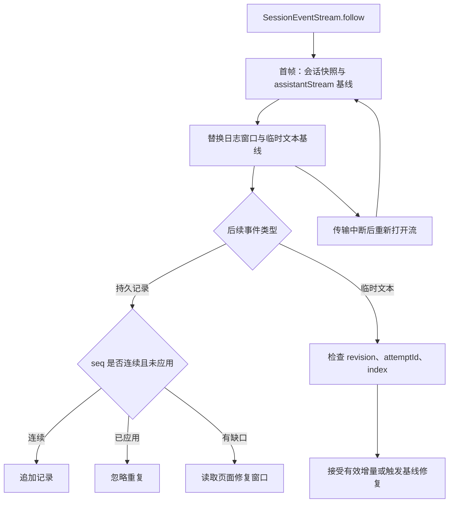

##### 图 2.2：建议的批量展示

下图为建议的批量展示流程；已有 Notifier 方法可参考，但当前会话调用链没有完成图中的按帧接入。

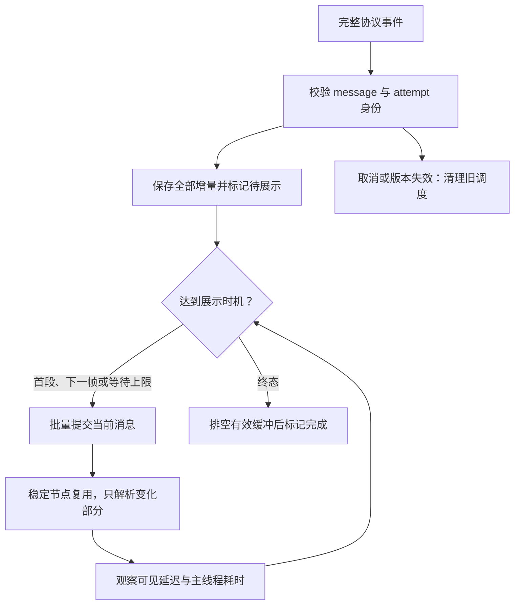

##### 图 2.3：现有取消与下一轮唤醒

下图表示“停止先到达服务端，新问题随后进入同一 Agent”的已确认路径。最前面的本地立即冻结、按 runId 定向取消仍是建议，不属于图中已有 cancel 方法的保证。

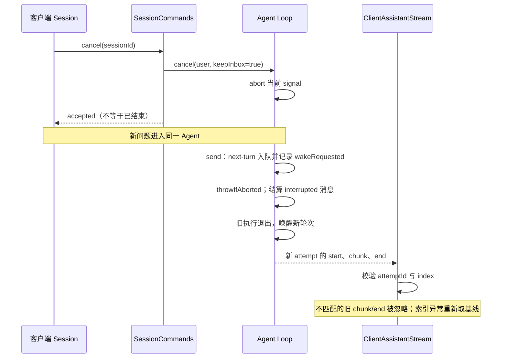

前端建议的事件准入顺序是：核对订阅 generation → 核对请求和 attempt → 检查消息是否允许更新 → 提交状态。失败的检查只阻止旧展示写入；历史结算和审计事件仍按自身身份保存，不能粗暴丢弃整个会话的所有旧事件。

##### 图 2.4：建议的消息编辑版本

下图描述建议的消息版本流程，复用了现有 attempt／generation 隔离思想，并非声称已有完整编辑接口。

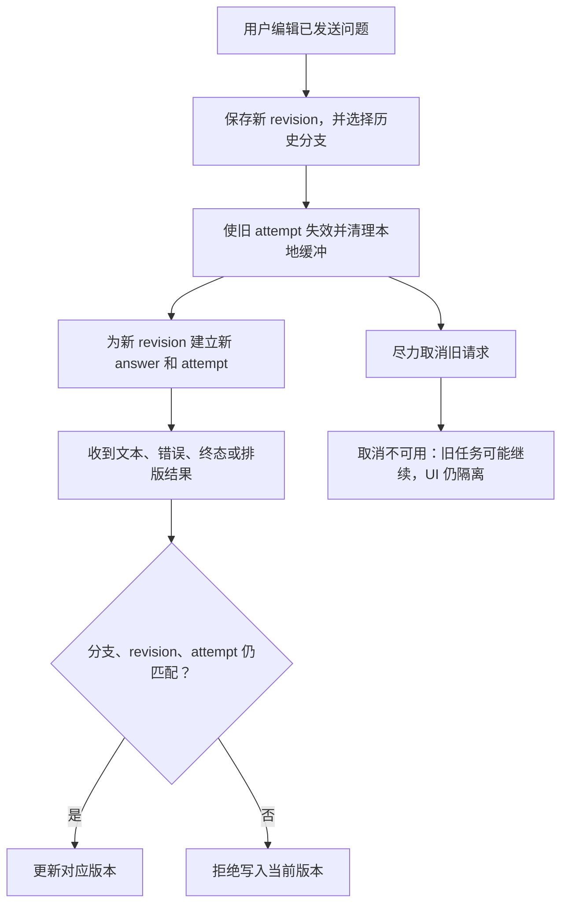

#### 验证记录与实现限制

本轮为静态分析，未运行测试。已检查 [未知 attempt 的 chunk 和 end 被忽略的测试](../packages/api/session-controller/tests/assistant-stream.client.spec.ts#L195)、[索引不连续时重建基线的测试](../packages/api/session-controller/tests/assistant-stream.client.spec.ts#L208)，以及 [取消尚未结束时接收新问题的测试](../packages/core/agent-loop/tests/cancel.spec.ts#L222) 和 [缓慢取消期间新消息不丢失的测试](../packages/core/agent-loop/tests/cancel.spec.ts#L293)。完整前端验收还应覆盖旧请求的迟到 chunk、error、done、finally、批量渲染回调、停止后不发新问题，以及停止命令晚于新提交到达的场景。记录中的引用目标、行号及空白格式已检查。

新增检查范围仍为静态分析：未运行 UTF-8／SSE 任意拆包、重放缺口、历史编辑、多标签页冲突、长文本压力、Profiler、弱设备或后台页测试。验收还需覆盖重连快照不重复追加、无服务端取消时的版本隔离和过期排版回调。按帧接入、正文虚拟化、Worker、历史 revision API 和 expectedRunId 取消属于建议，不能记录为已测收益或现成功能。

<a id="topic-3"></a>

### 3. MCP 工具确认、权限与审计

#### 问题与追问

**问题 3.1：** AI 助手通过 MCP 调用“查询订单”和“取消订单”工具。你会怎样设计界面和权限，避免模型误操作或用户误点？

**考察点：** 工具调用流程、用户授权、危险操作确认、审计。

**追问 3.1：** 如果模型给出的工具参数格式正确，但订单不属于当前用户，该在哪一层拦截？

**回答要点：** 模型提出操作，用户确认具体意图，服务端决定权限；三者不能互相替代。订单场景是建议设计，仓库提供的是通用工具、MCP 与审批设施。

#### 区分查询与修改，后端强制执行策略

查询订单通常可以在已授权范围内直接执行，但仍需校验订单归属，并限制返回字段，不能因为只读就允许查询别人的订单。取消订单属于有副作用的操作，需要明确的单次确认。只读和修改工具分别配置权限；工具是否可用、是否必须审批，由受控的服务端策略决定，不能由模型传入的 approved、工具描述或订单备注决定。订单备注等外部内容只作为数据，不能成为新增工具权限或跳过确认的指令。

仓库的 [MCP syncTools](../packages/mcp/mcp-client/src/tools.ts#L163) 将远端工具接入统一工具运行时，[createMcpToolDefinition](../packages/mcp/mcp-client/src/tools.ts#L322) 负责参数描述和执行适配，但这里没有自动将“取消订单”划为必须审批。[工具准备管线](../packages/core/tools/src/pipeline.ts#L191) 先执行 tools/pre-execute 策略，支持 allow、deny、ask、cancel，默认终点是 allow。因此必须显式配置取消订单的审批策略和允许的工具范围，不能宣称“接入 MCP 后危险操作自动安全”。

#### 确认内容必须具体，且绑定待执行动作

我会采用“准备取消 → 用户确认 → 执行”的流程。后端先根据登录身份查询有权访问的订单，生成确认预览；前端展示订单号、商品概要、金额、当前状态，以及取消对退款、发货和库存的实际影响。预览来自受信任的业务服务，不能只展示模型生成的一句总结，更不能把订单取消自动描述为退款完成。

按钮使用明确文案，例如“确认取消订单 #1234”和“保留订单”，不使用含义模糊的“确定/取消”。危险动作不默认获得焦点，不因弹窗出现时用户正在输入而被回车误触；批量取消应展示数量和具体范围。本次授权默认仅适用于该订单和该动作，不提供默认的“以后全部允许”。提交后禁止重复点击，后端仍以幂等键保证重复请求不重复执行。

审批记录绑定用户、租户、工具身份、目标订单、规范化参数摘要、订单版本和有效期。确认接口必须验证回答者身份，并消费服务器保存的一次性审批记录或受保护的凭证，不能信任模型附带的 approved: true。模型改了订单或关键参数、审批过期或取消、订单状态发生相关变化，都要重新准备和确认。

仓库的 [ApprovalPanel](../packages/client/ui-approval/src/client/ApprovalPanel.tsx#L9) 把按钮映射为 allowed-once 和 rejected；[ApprovalCard](../packages/client/ui-approval/src/client/ApprovalCard.tsx#L14) 按 requestKey 重建组件，用 waiting ref 和禁用按钮防重复提交，并处理输入法与重复按键。它仍有 Enter 批准行为，因此不能把它直接当作已满足订单危险操作全部交互要求的组件。[执行参数快照](../packages/core/tools/src/pipeline.ts#L153) 会复制并冻结参数，[PreToolDecision](../packages/core/tools/src/contracts.ts#L366) 明确禁止审批阶段改写已展示参数；这支持确认对象与执行对象一致，但跨网络审批的身份、有效期和业务版本绑定仍需业务实现。

#### 批准后仍需重新授权和检查业务状态

订单服务在真正执行前，从可信认证上下文取得当前用户和租户，重新检查取消权限、订单归属和允许的状态迁移。不能使用模型参数中的 userId 或 tenantId 作为授权依据。用户查看确认页期间，订单可能已发货或权限已撤销，因此展示预览时检查一次不够。

状态检查与修改应通过事务、行锁或带订单版本和状态条件的原子更新完成，避免检查后到执行前发生变化。如果预览已失效，返回“订单状态已变化，请重新确认”，不能照旧执行。调用远端订单系统时，校验必须落实到拥有订单数据的服务，并使用稳定 operationId 或下游幂等键，防止重复点击或网络重试重复触发退款、库存等副作用。

仓库的 [serviceAsk](../packages/core/tools/src/pipeline.ts#L453) 只把 allowed-once 转为允许；拒绝、取消、审批渠道缺失都转为拒绝。[prepare](../packages/core/tools/src/pipeline.ts#L214) 在批准之后还会执行 guards，并再次检查取消。这证明审批通过后仍可有强制检查，但这些通用 guards 不等于已经实现了订单归属和状态校验。

#### 审计记录授权过程与实际结果

审计应串联请求 ID、工具调用 ID、审批 ID 和业务 operationId，记录实际操作者、租户、目标订单、动作和参数摘要、审批人及时间、授权判断、状态版本、执行结果与错误码。记录拒绝和失败，也记录执行结果未知，不能把“用户已批准”记成“订单已取消”。敏感字段按需要脱敏，避免记录密钥和无关个人信息；审计存储需要独立的访问和修改权限。

仓库的 [ApprovalService.request](../packages/interaction/user-approval/src/index.ts#L243) 生成审批 ID，记录 approval/asked 和 approval/decided，并以 callId 关联工具调用；[BatchSettlement](../packages/core/tools/src/batch.ts#L243) 记录 tool/call 和 tool/result。[ApprovalService.decide](../packages/interaction/user-approval/src/index.ts#L294) 在审批通道不可用时拒绝放行，并在取消后丢弃迟到回答。它们提供关联记录和失败关闭机制，但不等于完整的订单业务审计或防篡改审计设施。

#### 追问：参数正确但订单不属于当前用户

必须在服务端的对象级授权层拦截，最终由拥有订单数据的订单业务服务执行。MCP 服务或 BFF 可以提前检查，但不能只在 React 隐藏按钮，也不能让模型判断用户有没有权限。即使绕过助手直接调用订单接口，也必须被拒绝。

参数格式正确只说明 orderId 是合法格式，不说明当前主体有权访问它。服务端应使用认证上下文中的 tenantId、userId 与 orderId 联合限定查询；商家员工场景则按其角色、门店和订单访问范围判断。资源不在授权范围内时，不执行取消，也不向调用者展示订单详情。按产品的资源隐藏策略返回无权访问或统一的资源不可用错误，不通过不同提示泄露他人订单是否存在。

仓库的 [Gateway.prepareInvocation](../packages/api/gateway/src/index.ts#L765) 提供了“格式校验不等于授权”的对应实现：先 validateArguments；对于非 owner principal，再用 principal、action 和 resources 调用 remoteAccess.decide；拒绝时在解析接收对象和调用业务方法之前抛出 remote-access/denied。这里是 Harness 远程资源授权，而且 owner 分支有明确区别；不能把它说成订单归属校验已经存在，更不能把 Harness 的 owner 身份直接当成所有业务订单的所有者。

#### 设计依据与取舍

| 问题或约束 | 设计选择 | 原因与限制 |
| --- | --- | --- |
| 模型能生成合法工具参数，但可能选错对象 | 将模型提议、用户同意、业务授权分开 | JSON 合法与用户有权操作是两件事 |
| 查询和取消的影响不同 | 查询做范围过滤，取消增加单次确认 | 只读也会泄露数据，确认也不能赋予越权能力 |
| 确认页与执行时刻之间状态会变化 | 绑定参数和版本，执行前重新授权并原子修改 | 避免确认后换单、改参或已发货仍取消 |
| 用户误点、重复点击、响应丢失 | 明确按钮文案、前端单次提交、后端幂等 | 前端防抖不足以阻止重复副作用 |
| 后续需要解释发生了什么 | 审批事件与实际执行结果关联记录 | 用户批准不等于操作成功，失败和未知结果也需保留 |

#### 涉及代码与职责

| 代码入口 | 输入与输出 | 职责与限制 |
| --- | --- | --- |
| [syncTools](../packages/mcp/mcp-client/src/tools.ts#L135) | MCP 工具列表 → ToolDefinition 注册 | 接入统一执行管线，但不会自动推断业务危险程度 |
| [prepare](../packages/core/tools/src/pipeline.ts#L191) | 工具调用 → allow、deny、ask、cancel 后的执行阶段 | 运行 pre-execute；未配置策略的终点默认 allow |
| [ApprovalService.request / decide](../packages/interaction/user-approval/src/index.ts#L243) | 审批请求 → 单次批准、拒绝、取消或不可用 | 保存审批记录，缺少回答通道时不放行 |
| [ApprovalPanel / ApprovalCard](../packages/client/ui-approval/src/client/ApprovalPanel.tsx#L9) | 待审批对象 → 用户回答 | 单次允许与拒绝；卡片的防重复提交实现见前文引用 |
| [serviceAsk 与 guards](../packages/core/tools/src/pipeline.ts#L453) | 审批结果 → 放行或拒绝 | 只有 allowed-once 允许继续，批准后仍有 guards |
| [MCP client.callTool](../packages/mcp/mcp-client/src/tools.ts#L178) | 工具名、参数、signal → MCP 结果 | 发起实际远端调用；订单对象级授权应由业务服务落实 |
| [Gateway.prepareInvocation](../packages/api/gateway/src/index.ts#L765) | 已校验参数和 principal → 授权判断 | 展示参数校验与资源授权分层；不是订单权限实现 |

#### 流程图

##### 图 3.1：MCP 审批与执行

下图表示已注册 MCP 工具通过通用工具管线执行的主要路径。订单预览、订单归属、状态版本和业务幂等需要在业务实现中加入，不由这条审批管线自动提供。

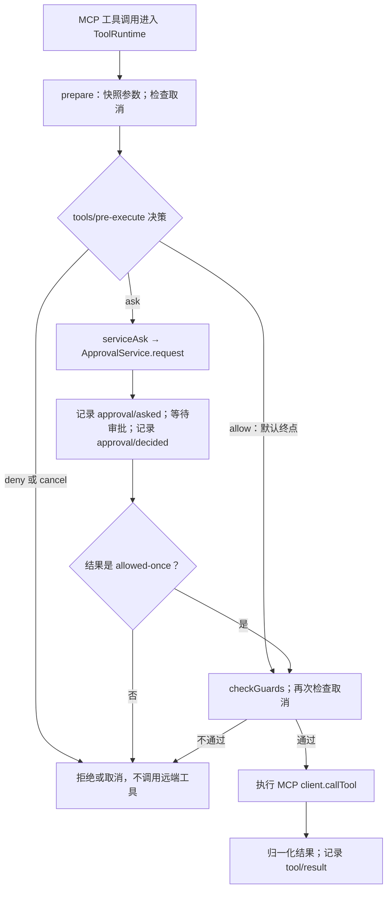

业务服务应另行执行：从可信身份取得用户及租户 → 查授权范围内的订单 → 校验单次确认和参数版本 → 原子检查当前状态并修改 → 返回真实结果。即使调用绕过 UI 或模型，这条业务授权路径仍必须生效。

#### 验证记录与实现限制

本轮为静态分析，未运行测试、未调用真实 MCP 服务或订单接口。检查了 MCP 桥接、工具策略、审批界面、审批审计和网关授权实现；引用目标、行号及空白格式已检查。订单业务验收应覆盖跨用户和跨租户订单、伪造或重放审批、审批后改参、订单版本变化、权限撤销、连续点击、取消后的迟到批准，以及副作用完成但响应丢失的场景。

<a id="topic-4"></a>

### 4. RAG 引用设计、可信度与排障评测

#### 问题与追问

**问题 4.1：** AI 根据内部文档回答问题。前端要展示引用，让用户判断答案是否有依据。你会如何设计数据结构和交互？

**考察点：** 引用对齐、可追溯性、加载状态与错误处理。

**追问 4.1：** 如果回答中的一句话混合了多个来源，怎样避免引用标记让用户误以为每个来源都支持整句话？

**问题 4.2：** RAG 聊天界面引用了知识来源，但用户说答案“看起来不对”，你如何定位问题？

**考察点：** 检索与生成的可观测性、引用对齐、评测闭环。

**追问 4.2：** 怎样设计指标，区分检索质量差和模型没有遵循检索结果？

**回答要点：** 引用是具体结论到具体版本证据的映射。界面支持核对，排障追踪证据从检索到最终上下文的全过程；检索相关性、答案忠实度与事实正确性分别评估。仓库已有 Web 搜索来源链路，完整内部 RAG 方案仍需补充。

#### 数据结构：结论、证据片段、文档来源分开

后端返回 answerId、revision 和以下三类结构，引用使用稳定 ID，显示序号仅由前端生成。

| 对象 | 建议字段 | 用途 |
| --- | --- | --- |
| sources | sourceId、documentId、version、title、url、updatedAt、retrievedAt | 标识具体文档版本，区分更新时间与检索时间；缺失字段不编造 |
| evidence | evidenceId、sourceId、chunkId、locator、quote | 保存实际检索到的原文片段；locator 是章节、段落、页码等位置 |
| claims | claimId、text、evidenceIds、relation、citationState | 标识可独立核对的结论及其证据；relation 区分直接陈述、归纳推断等，citationState 区分待关联、已关联、无依据、存在冲突 |

同一文档的两个段落应保留不同 evidenceId，不能仅因 URL 相同就合并成一个证据。单个 claim 可以关联多个证据，但这些关系只是可检查的归因，不代表系统已证明结论正确。复杂结论还可以用 premises 和联合证据组表达推断所依赖的不同前提。

后端从本次检索且当前用户有权限的结果中建立来源表，让模型引用其中的 ID；标题、链接、版本和原文摘录由检索结果解析，不能由模型任意编造。完成前校验引用 ID 存在、所属版本一致、摘录确实出现在对应片段中；这些结构校验仍不能替代“原文是否真的支持结论”的语义检查。无法建立对应关系时标为无依据或需要核对，不能随意挂一个相似文档。

仓库的 [WebSearchResult 与 WebSearchSource](../packages/web/web/src/types.ts#L43) 已有 sources、url、title、snippet、summary、publishedAt 和 truncated，但没有上述 claimId、evidenceId 和版本段落映射。[citationSnippets](../packages/web/web-search-deepseek/src/provider.ts#L135) 按 URL 取首次摘录，[mapAnthropicResponse](../packages/web/web-search-deepseek/src/provider.ts#L171) 按 URL 去重，适合来源卡片；直接用作细粒度 RAG 证据可能丢失同一文档多个引用位置。

#### 引用交互：双向定位与原文上下文

引用标记放在被支持的最小结论之后。悬浮、键盘聚焦或点击时，同时标出回答中的对应结论和来源摘录；侧栏展示文档标题、版本或更新时间、章节或页码、原文及必要上下文，并提供“打开原文”。不能只高亮关键词，还要保留例外条件、否定词和适用范围。

原文发生更新时，应说明“本回答依据版本 X，当前文档已更新”，在权限允许且版本存储可用时打开引用版本；不能悄悄用最新版正文替换历史证据。版本不可用、无权查看、链接失效和片段加载失败要分别显示，保留仍可合法显示的答案和引用元数据，提供重试或重新检索。重新检索可能产生不同证据，应形成新的答案修订，不伪装成恢复了旧版本原文。

内部文档需要在检索过滤、生成上下文、来源预览和打开原文时执行访问控制；不能仅在点击链接时才鉴权，否则标题、摘录甚至答案本身已经泄露。链接应来自受控来源，使用安全协议或内部文档路由；文档内容作为数据渲染，不把其中的 HTML 或指令直接执行。

仓库的 [SourceItem](../packages/client/ui-primitives/src/WebBlock.tsx#L130) 展示标题链接、snippet 和日期，[SafeLink](../packages/client/ui-primitives/src/WebBlock.tsx#L110) 配合 safeHref 仅把 HTTP(S) 地址渲染成外链。它们是来源展示和链接安全基础，不包含上述内部文档权限、原文定位或版本访问实现。

#### 流式引用与状态拆分

生成状态和证据状态分别维护：回答可以仍在生成，但某些结论的证据已经确定；回答也可以生成完成，但部分结论没有来源。检索状态至少区分检索中、成功命中、成功但无结果、检索失败；证据详情单独维护加载中、可用、无权限、失效和加载失败。不能把检索失败转换为空来源数组后显示“没有相关文档”，因为系统根本没有完成检索。

流式事件携带 answerId、attemptId、revision 和 claimId。正文增量、证据关联和结论完成分别更新，旧尝试事件不能污染新答案。引用尚未解析时显示“来源待关联”，不先渲染假的链接。优先用不可变的结论片段或结构化文本节点关联引用；若必须用字符区间，需要绑定精确文本修订并约定偏移单位，不能把 Markdown 原文偏移直接套到渲染后的 DOM。答案改写时应同步替换受影响的引用映射，避免标记漂移。

仓库的 [WebSearchMeta](../packages/web/tool-web/src/search.ts#L120) 把来源字段和可选回答保存到工具结果元数据，支持历史回放；[searchMetaFromResult](../packages/web/tool-web/src/search.ts#L204) 验证元数据，异常时允许回退到通用展示。[WebSearchBlock](../packages/client/ui-primitives/src/WebBlock.tsx#L150) 显示无结果和来源截断提示，[webCardModel](../packages/client/ui-tool/src/client/tool/models/web-card-model.ts#L58) 不把工具错误渲染成成功的 Web 卡片。另外，[mapAnthropicResponse](../packages/web/web-search-deepseek/src/provider.ts#L159) 在缺少搜索结果块时抛出 WEB_PROVIDER_ERROR，而不是伪装成检索成功但无结果。这些是区分异常和空结果的依据，并非完整的逐结论 RAG 状态机。

#### 可信度不等于相似度

相似度衡量检索相关性，不代表原文真实、版本最新，更不代表原文支持回答的全部含义。不能把 0.92 相似度展示成“答案正确率 92%”。我会展示可核对的信息：来源版本、适用范围、直接引用还是归纳推断、缺失依据和来源冲突；“已关联来源”也不应包装成“已验证正确”。有冲突时保留不同来源及其日期，不静默挑一个；关键业务决定提示用户核对原文的条件和例外。

#### 追问：一句话混合多个来源

优先把一句复合陈述拆成可独立判断的子结论，各自紧跟自己的引用。例如假设来源 A 只说明“未发货订单可以申请取消”，来源 B 只说明“审核通过的退款预计 3–5 个工作日到账”，应展示：

> 未发货订单可以申请取消。[A] 审核通过的退款预计 3–5 个工作日到账。[B]

不能改写为“取消订单后一定在 3–5 个工作日退款到账。[A][B]”，因为这删掉了审核条件，还增加了取消必然触发退款的因果关系。

如果产品需要保留一个句子，就将引用绑定到明确的子句或文本节点，点击 A 只高亮 A 对应的子句，点击 B 只高亮 B 对应的子句。不能只在句末并排放两个标记，让用户猜它们分别支持什么。

如果结论确实需要综合 A 和 B 才能推导，应标记为“基于 A、B 的归纳”，展示各自支持的前提与适用条件；证据组表达联合支持，不声称任一来源单独支持整句。没有证据支持的连接关系要删掉或明确为待验证推断。无法实现细粒度绑定时，拆句或分点比添加模糊的整句引用更合适。

#### 保存可复现的排障证据

建议为一次回答保存 traceId、sessionId、messageId 和 attemptId，并将以下记录关联起来：原始问题与改写问题、用户可访问范围、索引和文档版本、embedding 与重排模型版本、候选 chunkId／排名／分数、重排后的结果、最终进入模型上下文的片段及其顺序、因 token 预算被删去的片段、生成模型与提示模板版本、答案和逐断言引用映射。版本要能定位当时的内容，不能只记录会持续变化的文档 URL。

观测数据遵守知识库本身的权限与保留策略。默认记录必要的标识和脱敏摘要；确需保存完整问题或片段时放入受限存储，不能把内部文档、个人信息或凭据无差别发往公共日志。为了排障保存的数据，也不意味着可以绕过文档权限向其他用户展示。

这些 trace 字段需要在上述 Web 来源结构之外增加：当前链路没有完整的内部 RAG 候选分数、重排与版本追踪，不能由来源卡片推断已经具备。

#### 按错误出现的位置逐层定位

1. **知识本身是否正确、当前用户是否有权限。** 检查原文版本、有效期和相互冲突的条款。错误或过期文档即使被忠实引用，答案仍可能不正确；越权文档则应在检索或取内容时被过滤，而不是到 UI 才隐藏链接。
2. **候选检索是否召回证据。** 看改写是否误解问题、索引是否漏更新、chunk 是否拆断限定条件、过滤条件是否过严。正确证据未进入候选集时，先定位召回问题。
3. **重排和上下文组装是否丢了证据。** 候选集有正确片段，但重排把它排出 top-k，或最终 prompt 因长度预算截断了它，都不应归因于“模型没有用”。要核对真正发送给模型的内容，不能只看检索日志。
4. **生成是否遵守已提供证据。** 上下文足够且正确时，检查模型是否忽略条件、混淆版本、拼接互相冲突的规则，或引入无依据结论。涉及多条事实时逐条核对，不能只比较整体语义相似度。
5. **引用和界面是否错位。** 检查引用 ID 是否对应当时的 chunk、偏移是否随编辑变化、重连后是否混入旧 attempt 的来源、跳转是否指向新版本而非被引用版本。生成正确但 UI 标错来源，也是单独的问题。

引用展开应展示准确片段、文档标题与版本，并允许反馈“内容错误、来源不支持、来源过期、引用位置错误”等原因。仓库的 [WebSearchBlock](../packages/client/ui-primitives/src/WebBlock.tsx#L150) 展示来源与截断状态；[MessageFeedbackController.rate](../packages/client/ui-message-feedback/src/client/controller.ts#L161) 和 [putCommitted](../packages/client/ui-message-feedback/src/client/controller.ts#L190) 按 sessionId、messageId 保存 rating、note、category，并带 ifVersion。这能承载消息级反馈，但并不自动完成 trace 关联、训练集建设或 RAG 质量评估。

#### 追问：分开衡量检索质量与生成忠实度

建立有人工核对的真实问题集，为每题标注是否可回答、所需证据及原文版本、关键断言与适用条件。多跳问题标注完整证据集合，不能找到一个相关片段就算成功。按业务域、文档时效、问题类型和权限场景分层，避免平均分掩盖某类系统性失败。

| 层级 | 指标与计算对象 | 低分主要说明什么 |
| --- | --- | --- |
| 候选召回 | Recall@k：候选中命中的标注证据数／全部必需证据数；另计完整证据集合命中率 | 是否把回答需要的材料找回来 |
| 重排 | 对同一候选集计算 nDCG@k；单个关键答案场景可看 MRR；比较重排前后证据保留率 | 是否把已找到的正确材料排到前面 |
| 上下文组装 | 实际送入模型的必要证据覆盖率、完整证据覆盖的题目占比 | 是否在预算、去重或拼接过程中丢失条件 |
| 生成 | 在“实际上下文足够回答”的样本上，计算被上下文支持的可核查断言数／全部可核查断言数，并单独评估答案正确性与完整性 | 有证据时是否仍编造、误读或遗漏 |
| 引用对齐 | 引用支持率：确实支持对应断言的引用关系数／全部引用关系数；引用覆盖率：带有效支持引用的应引用断言数／全部应引用断言数 | 是否标对来源，以及是否遗漏需要引用的断言 |
| 无答案处理 | 不可回答样本的正确拒答率、可回答样本的误拒答率；拒答样本不按空断言自动算忠实度满分 | 是否在证据不足时停止猜测，或过度拒答 |

除上述相似度限制外，重排分数也不是可跨模型版本直接比较的概率。忠实度与正确性要分开：模型可以忠实复述错误文档，也可能凭预训练知识说对事实但没有检索依据。只报告一个“答案准确率”无法定位责任层。

为了进一步归因，可以做受控对照：固定生成模型与提示，分别输入实际检索上下文和人工标注的充分上下文；若换成充分上下文后明显改善，检索或组装更值得排查。反过来固定同一充分上下文比较生成版本，观察忠实度和引用变化。这些结果是定位证据，不是对单一原因的绝对证明。LLM 评审可辅助批量评分，但要用人工抽检校准，并防止评审器只认可答案语气或表面引用。

#### 设计依据与取舍

| 问题或约束 | 设计选择 | 原因与限制 |
| --- | --- | --- |
| 列出文档不能说明它支持哪句话 | claims、evidence、sources 分开建模 | 将回答结论关联到具体版本的具体段落 |
| 同一 URL 可能支持不同子句 | 文档来源可去重，证据片段保持独立 ID | 避免合并摘录后丢失精确支持关系 |
| 答案和引用可能分批到达、发生改写 | 绑定 answerId、attemptId、revision、claimId | 防止引用标记漂移或来自旧尝试 |
| 检索失败与成功但无结果不同 | 检索、生成、证据加载使用独立状态 | 让用户知道是系统故障，还是确实未找到依据 |
| 相关性高不代表结论被支持 | 不显示伪正确率，保留条件、版本和冲突 | 结构关联与语义支持都不能自动等价于事实正确 |
| 一句话包含多个来源的不同前提 | 拆成子结论，或显式标注联合归纳 | 避免句末多个标记制造整句均被支持的错觉 |
| 用户只说“不对” | 定位消息、断言、版本和反馈原因 | 把主观反馈转成可复现案例 |
| 检索到了但最终没进 prompt | 保存各阶段结果及排除原因 | 避免把组装丢失误判成生成不忠实 |
| 引用存在但支持关系错误 | 按断言评估引用支持率和覆盖率 | 来源数量不能替代证据质量 |
| 总体分数无法归因 | 分层指标与充分上下文对照 | 单独衡量找证据和用证据的能力 |

#### 涉及代码与职责

| 代码入口 | 输入与输出 | 职责与限制 |
| --- | --- | --- |
| [citationSnippets](../packages/web/web-search-deepseek/src/provider.ts#L135) | 供应商文本块 → URL 到首次摘录的映射 | 提取摘录；不能表达同 URL 的多个独立证据 |
| [mapAnthropicResponse](../packages/web/web-search-deepseek/src/provider.ts#L159) | 供应商结果块 → 带去重来源的 WebSearchResult | 缺失结果块时报错；关联摘录并按 URL 去重；URL 去重不能替代文档版本／chunk 追踪 |
| [WebSearchResult / WebSearchSource](../packages/web/web/src/types.ts#L43) | 来源、可选回答、截断信息 | 现有统一来源数据，尚无逐结论映射 |
| [searchMetaFromValue](../packages/web/tool-web/src/search.ts#L179) | 搜索结果 → 可回放元数据 | 保存显示字段，避免重新从有损文本反推来源 |
| [webCardModel](../packages/client/ui-tool/src/client/tool/models/web-card-model.ts#L58) | 工具状态与元数据 → 卡片数据或通用回退 | 检查结果状态与元数据类型；错误和未完成状态不能伪装成有效来源卡片 |
| [WebSearchBlock / SourceItem](../packages/client/ui-primitives/src/WebBlock.tsx#L130) | 来源字段 → 标题、摘录、日期和链接 | 展示来源列表、空结果及截断提示 |
| [WebSearchSource](../packages/web/web/src/types.ts#L65) | 来源信息 → 统一来源字段 | 已有字段不含完整 RAG 阶段观测数据 |
| [searchMetaFromResult](../packages/web/tool-web/src/search.ts#L212) | 工具结果 → 搜索元数据 | 观察来源如何进入工具展示链路 |
| [WebSearchBlock](../packages/client/ui-primitives/src/WebBlock.tsx#L150) | 来源和截断标记 → 展示 | 已有来源入口，非答案正确性证明 |
| [MessageFeedbackController.putCommitted](../packages/client/ui-message-feedback/src/client/controller.ts#L190) | 消息反馈 → 带版本条件的保存请求 | 可关联消息，RAG trace 关联仍需设计 |

#### 流程图

##### 图 4.1：现有 Web 来源卡片数据流

下图是现有 Web 来源卡片的数据流，不是完整的内部文档 RAG 实现。展示映射关系的箭头描述数据来源，不表示每一步都是直接函数调用。

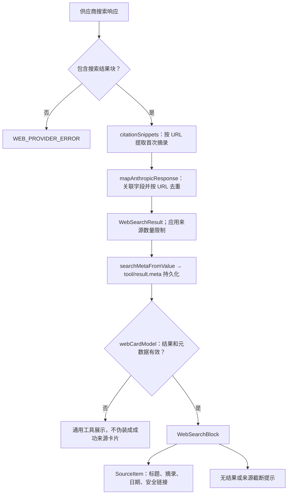

建议新增的引用映射是：claimId → 一个或多个 evidenceId → sourceId 对应的文档版本和段落。句子由多个子结论构成时，先拆分 claim，再关联证据；联合推断另行标注，不能把检索结果列表直接当成逐句证据。

##### 图 4.2：现有来源反馈与建议的 RAG 排障

上半部分为现有 Web 来源与反馈代码；下半部分为建议的内部 RAG 排障流程，两者不能等同。

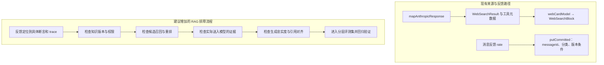

#### 验证记录与实现限制

本轮为静态代码分析，未运行测试或真实检索；只修改面试记录。已核对来源类型、搜索适配、持久化元数据与前端展示代码，并检查记录的引用目标、行号及空白格式。上述逐结论证据结构、版本定位及内部文档权限是建议设计，不能认定仓库已有完整实现。验收应覆盖多来源子句、同文档多片段、伪造来源 ID、引用条件缺失、流式改写造成错位、检索失败与空结果、权限撤销、版本变化和来源冲突。

未运行人工标注、RAG 离线评测或线上排障。阶段 trace、指标、充分上下文对照和反馈闭环仍为建议；不能由消息级反馈接口推断已有自动评测系统。

<a id="topic-5"></a>

### 5. 模型输出安全、结构化 UI 与 Markdown 排版

#### 问题与追问

**问题 5.1：** （2/2）模型会返回文本、代码片段，或类似 JSON 的结构化 UI 描述。前端如何展示这些结果，同时避免 XSS、无效结构和页面崩溃？

**考察点：** 不可信输入处理、结构化输出校验、错误边界。

**追问 5.1：** 如果产品确实需要展示模型生成的 HTML，怎样做隔离和安全审查？

**问题 5.2：** AI 生成的 Markdown 含代码块、链接和 HTML 时，前端怎样安全地渲染？

**考察点：** XSS、内容清洗、链接协议与流式渲染。

**追问 5.2：** 只对最终完整内容做清洗，流式阶段直接渲染，有什么风险？

**问题 5.3：** AI 回答中包含 Markdown 表格、代码块和公式，如何兼顾流式渲染与最终排版？

**考察点：** 增量解析、未闭合语法、渲染成本。

**追问 5.3：** 如何处理流结束时仍不完整的 Markdown 结构？

**回答要点：** 模型输出始终作为不可信数据。文本、Markdown、结构化 UI 和 HTML 预览采用不同受控入口；每次流式展示和最终排版都遵守相同安全策略。运行时校验、错误隔离、资源限制和执行沙箱分别承担不同职责。

#### 文本、代码和 HTML 的安全入口

普通文本使用 React 文本节点，代码放进 pre/code，允许复制和高亮，但不调用 eval、new Function，也不把模型输出当 JSX 编译进主应用。Markdown 的 HTML、链接和资源策略见下文。

[AssistantMarkdown](../packages/client/ui-chat/src/client/chat/AssistantMarkdown.tsx#L83) 将文本交给专门的 MarkdownText，未知块回退为 JsonBlock。

仓库的 [render](../packages/client/ui-primitives/src/markdown/render.tsx#L376) 对 HTML 节点的实际处理是：

```tsx
case 'html':
  return context.omitHtml ? null : node.value
```

返回 node.value 是字符串节点，内容会作为文本处理；它不是把模型 HTML 传入 dangerouslySetInnerHTML。代码围栏进入 CodeBlock；[highlightToHtml](../packages/client/ui-primitives/src/markdown/highlight.ts#L469) 调用高亮器生成标记，[CodeBlock](../packages/client/ui-primitives/src/markdown/CodeBlock.tsx#L224) 注入的是高亮器产生的静态 span HTML，未就绪时用 pre/code 文本回退。对应的[完整高亮入口](../packages/client/ui-primitives/src/markdown/CodeBlock.tsx#L202)仅处理高亮器产物；安全依据是高亮器对原始代码的转义保证。不能仅凭 dangerouslySetInnerHTML 断言 XSS，也不能因使用高亮库就免于审查。更换高亮器或插件时应核对有无原始 HTML 透传，并维护依赖和恶意输入回归。

#### 链接协议、跳转和资源加载

我会优先采用业务明确允许的协议，例如网页链接只允许 http 和 https，确需 mailto 等协议时单独开放；拒绝执行脚本、内联数据和未经授权的本地资源入口。用 URL 解析结果判断协议，不能只凭字符串前缀。外部新窗口链接附带 noopener noreferrer；但这些属性不阻止钓鱼或恶意站点，链接展示仍应让用户看清目标。

仓库的 [sanitizeUrl](../packages/client/ui-primitives/src/markdown/render.tsx#L55) 实际使用危险协议拒绝列表：禁用 javascript、vbscript、data、blob，拒绝无法解析的地址；它不是只允许 http/https 的严格白名单。[MarkdownAnchor](../packages/client/ui-primitives/src/markdown/render.tsx#L602) 为 HTTP(S) 设置 target 和 rel；[remoteImageUrl](../packages/client/ui-primitives/src/markdown/render.tsx#L74) 限制远程图片为 HTTP(S)。面试中的严格协议白名单是建议策略，不能说当前代码已经全面实现。

本地文件链接走专门的文件 delegate，并在流式阶段保留为文字，见 [renderAnchor](../packages/client/ui-primitives/src/markdown/render.tsx#L629)。此外，允许 HTTP(S) 图片不等于没有隐私风险：它仍可能向外站发起请求。内部知识场景可按产品需要加入图片代理、域名策略或用户确认加载，这些不是当前函数已经保证的能力。

#### 流式内容未闭合时也不能绕过安全策略

增量 Markdown 解析必须接受未闭合代码围栏、链接和公式，并在更多文本到来时更新尚未稳定的部分。不能假设上一帧的文本结构永远不变，例如后续引用定义可能改变前文链接的解释。为了性能可以冻结稳定块、重解析尾部，结束后再做一次完整解析；冻结策略只能影响展示时机，不能让某个阶段绕过 URL 检查或 HTML 策略。

仓库的 [StreamingRenderer](../packages/client/ui-primitives/src/markdown/MarkdownText.tsx#L69) 使用增量解析与缓存，冻结部分和尾部都通过 renderBlocks 渲染；[renderSettled](../packages/client/ui-primitives/src/markdown/MarkdownText.tsx#L31) 在完成后做整体解析。文件开头明确说明跨冻结位置的引用链接／脚注可能在完成前暂时保持字面文本。这是有说明的显示限制，不应为立即展示完整语法改成直接插入 HTML。

#### 追问：为什么只清洗最终结果不够

浏览器在每次插入 DOM 时就可能触发事件处理器、资源请求或危险导航，攻击不需要等回答完成。即使最终内容被清理，之前触发的副作用也无法撤销；如果用户中途停止或网络断开，最终清洗甚至不会发生。

风险也可能跨 chunk 形成：例如属性、标签或链接目的地被分成几段，后续文本使累计内容成为可执行结构。不能孤立清洗每个碎片再认为拼接后仍安全；应按最终渲染使用的累计结构解析，并确保每次进入 DOM 的内容都经过相同策略。安全属性还要覆盖 Markdown 插件、语法高亮和链接组件，不能只过滤 `<script>` 字面量。

验收时我会对同一恶意输入按不同字节和字符位置拆分，逐帧检查 DOM 是否出现事件属性、危险 href 或未经允许的资源，并覆盖中止、断线和最终重解析。安全验证应观察执行／网络行为以及生成 DOM，单靠最终 HTML 快照不能证明流式过程中没有副作用。

#### 表格、代码块与公式的流式排版

保留完整 Markdown 原文作为唯一内容依据，流式视图只是可更新的展示结果。将已经稳定的块缓存起来，只重解析尚可能变化的尾部；代码和公式按各自的计算成本选择增量或延迟排版。收到明确终态后，对累计原文做完整解析以解决引用、脚注和公式等全局问题；不要求为了“最终排版”无条件重做所有已正确缓存的高亮。

仓库 [IncrementalMarkdownParser.update](../packages/client/ui-primitives/src/markdown/incremental.ts#L310) 冻结除尾部两个块之外的稳定部分；非追加文本会重置缓存 generation，避免编辑后的内容沿用旧解析。未闭合的大型顶层代码围栏有单独的行级处理，不能简单理解为“整个代码块没闭合就每次全部重解析”。不过 startsWith 的前缀比较和不断增长的尾部仍有成本，这不是对任意输入长度的常量时间保证。

表格只有在解析器确认表头、分隔行和后续行结构后才按表格显示，未形成表格时允许保持文本；不为每个 token 手工猜测列数或补齐数据。新增内容可能改变列宽，使用可滚动容器、稳定 key 和合并提交减少布局跳动，同时保持用户阅读位置。[renderTable](../packages/client/ui-primitives/src/markdown/render.tsx#L529) 已按列数选择宽表处理并包裹滚动容器，但它仍会映射当前表格行；单个超大表格仍需单独做成本评估，不能认为块缓存自然解决全部表格开销。

代码方面，[StreamingHighlightSession](../packages/client/ui-primitives/src/markdown/highlight.ts#L552) 缓存已完成行的高亮状态，只处理新增行和变化尾部；[CodeBlock](../packages/client/ui-primitives/src/markdown/CodeBlock.tsx#L156) 在结束时发现代码与语言未变，会复用已有渲染结果，否则才按完整内容高亮。因此“结束后完整解析”不等于“结束后必须重复全量高亮”。未知语言或尚未加载的语法先按文本展示，不能为等待高亮隐藏可读内容。

公式方面，[parseGfm](../packages/client/ui-primitives/src/markdown/parse.ts#L31) 的流式语法不启用数学扩展，TeX 暂时按字面内容展示；结束后 [parseGfmWithMath](../packages/client/ui-primitives/src/markdown/parse.ts#L44) 再识别公式。这避免半个公式频繁触发错误和排版变化。KaTeX 与当前高亮实现仍有同步计算，不能称为已移入 Worker。若实测出现长任务，可分批处理可见块、延迟屏幕外公式或引入适合 Worker 的解析／高亮部分；异步结果必须带消息版本，过期结果不能覆盖新答案。

#### 追问：流结束时 Markdown 仍不完整

先区分“协议完成”和“语法看起来没闭合”。正常终态的原文交给完整解析器处理：例如未闭合围栏可按语法规则将余下内容作为代码块；不成立的表格或链接按解析结果显示为普通文本，不丢内容，也不为了美观篡改原文。如果断线、用户停止或达到输出长度上限导致内容截断，除安全显示收到的内容外，还应标记回答不完整，并提供明确的续写或重新生成入口；不能靠补一个围栏就把业务状态改成完成。

无法解析的公式保留源码或局部错误提示。仓库 [renderTexToReact](../packages/client/ui-primitives/src/markdown/katex.tsx#L66) 先正常渲染，遇到错误再使用非抛错模式，内部错误则回退为包含原文的错误 span。产品可以选择更友好的局部提示，但不能使整条回答崩溃。最终渲染继续遵守本题前文的 HTML、URL 和代码安全规则，结束不是放宽策略的理由。

如果产品希望临时补闭合符改善预览，只能在独立的展示副本中做明确、可撤销的处理，原始内容、复制、导出和审计仍保留真实文本；更简单可靠的默认是让成熟解析器容错。尤其不能自动补 JSON 参数并据此调用工具，Markdown 预览修饰不具有修改业务数据的权限。

#### 结构化 UI：严格数据协议和组件白名单

模型支持结构化输出时优先提供带 schemaVersion 的 JSON Schema，但响应仍以 unknown 进入后端和前端，在各自不可信输入入口验证。检查类型、必填字段、枚举、未知字段、字符串长度、数组数量、树深度和总节点数；JSON.parse 成功只代表语法正确，TypeScript 的 as UiSpec 也不产生运行时保障。校验器和解析器本身还需要输入体积限制，不能先解析无限大数据再截断显示。

仅把 Text、List、Table、Card 等允许的 kind 映射到固定组件，并显式构造允许的 props。模型不能提供任意标签、组件模块路径、事件函数、dangerouslySetInnerHTML、任意 CSS 或网络地址；也不能把任意 props 对象展开进组件。按钮只能选择受控 actionId，映射到应用已有动作，执行时仍经过后端鉴权和必要审批，不能让模型提供任意 JavaScript 或 URL 来替代。

流式 JSON 未完整时先显示生成状态，或只展示逐个验证完成的独立块；不使用 eval 修复“类似 JSON”，也不把不完整对象强转为 UI。未知 schemaVersion、组件类型或字段错误时，显示可理解的失败提示，并回退为有长度限制、经过文本转义的原始内容。

仓库的 [webCardModel](../packages/client/ui-tool/src/client/tool/models/web-card-model.ts#L33) 是一个具体例子：从未知元数据检查数组、对象和字段类型，显式复制字段；异常数据返回 null 走通用展示。这不是通用模型 UI schema 引擎。本题的版本化组件协议、深度限制和 actionId 白名单属于建议设计。

#### 防止局部失败扩散

按消息或组件块设置 Error Boundary，一个卡片渲染失败只替换该块，保留输入框和其他消息。解析失败、网络失败和异步渲染资源加载失败分别处理；日志记录错误类型、组件和响应标识，避免直接上传全部敏感输出。

仓库的 [SlotErrorBoundary 与 FactoryErrorBoundary](../packages/client/ui-renderer/src/client/scoped-slots.tsx#L444) 在局部记录错误并返回替代节点，部分组装错误会继续抛给外层。错误边界不是 XSS 防护，也不会自动捕获事件处理器、普通异步回调或自身的错误；这些路径需要显式处理，具体范围参见 [React 错误边界文档](https://react.dev/reference/react/Component#catching-rendering-errors-with-an-error-boundary)。

超大文本、深层 UI 树、昂贵高亮和无限循环也不是错误边界能解决的。限制输入大小、节点数量和计算量，大任务按需放到可终止的 Worker。仓库的 [JsonBlock](../packages/client/ui-primitives/src/markdown/JsonBlock.tsx#L6) 在展开后序列化并截断到 20,000 字符，用 pre 文本显示；这个限制发生在 stringify 之后，不能把它当作解析或序列化阶段的内存与耗时限制。

#### 追问：必须展示模型 HTML

先确认产品只需要静态排版，还是需要执行脚本。两者是不同能力，不能为了展示 HTML 默认开放脚本。

静态模式使用维护中的 HTML 清理器，明确允许的标签、属性和 URL；去掉脚本、事件属性、危险 URL、表单、嵌套文档和不需要的 SVG/MathML 等功能，不用正则代替 HTML 清理。在独立 iframe 中使用空 sandbox，不授予脚本、表单、弹窗或顶层导航能力，并配合 CSP 限制脚本和资源加载，禁止不需要的网络、嵌套 frame、form-action 和 base-uri。样式和图片按明确需求开放，链接和导航另行限制；仅有 iframe sandbox 并不等于阻断网络。

仓库的 [createBasicHtmlDocument](../packages/client/ui-sidebar-documentpreview/src/client/html/basic-document.ts#L10) 已使用 DOMPurify、移除若干危险元素和链接属性，并插入 default-src 'none'、script-src 'none'、connect-src 'none' 等 CSP；[BasicHtmlFrame](../packages/client/ui-sidebar-documentpreview/src/client/html/HtmlBody.tsx#L91) 用 srcDoc 和 sandbox="" 承载。这是“内容清理 + 浏览上下文隔离 + 资源限制”的实际代码依据，而不是把模型 HTML 塞进聊天页面 DOM。

如果业务确实需要运行脚本，我会作为单独的执行功能审查：使用与业务站点隔离的来源，不共享登录凭据，不暴露宿主 API，只授予必需的 sandbox 能力，限制网络与导航，并提供停止和销毁运行环境的能力。同源嵌入时不能同时放开 allow-scripts 和 allow-same-origin 来承载不可信内容；[MDN iframe 文档](https://developer.mozilla.org/en-US/docs/Web/HTML/Reference/Elements/iframe#sandbox) 明确指出这种组合可能使沙箱失效。iframe 也不是 CPU 或内存配额系统；任意代码的强资源隔离需要更独立、可终止的执行环境。

需要父子通信时，仅开放固定、低权限消息类型，校验消息来源窗口、可验证的来源和消息结构；opaque origin 的 "null" 不能当作唯一身份凭据，应把通道绑定到具体 iframe 实例。子页面不能通过消息获得通用 fetch、执行脚本或调用业务工具的权限，涉及业务副作用仍走宿主鉴权审批。

仓库另有 [交互预览 iframe](../packages/client/ui-sidebar-documentpreview/src/client/html/HtmlBody.tsx#L68)，只设置 sandbox="allow-scripts"，没有 allow-same-origin；其 [bootstrap](../packages/client/ui-sidebar-documentpreview/src/client/html/bootstrap.ts#L24) 会在 iframe 内写入原始 HTML。该路径没有沿用静态清理函数及其 CSP，因此不能把静态模式的“无脚本、无网络资源”保障套到交互模式上。本轮没有对交互预览的整体部署和网络隔离做完整安全审计。

安全审查应覆盖原始输出到最终 DOM 的完整路径，而不是只扫 script 标签：测试 onerror、危险 URL、SVG/MathML、编码混淆、DOM clobbering、外链和导航、表单提交、跨 frame 消息、超大输入及依赖更新回归。清理后不能再拼接不可信内容；[DOMPurify 文档](https://github.com/cure53/DOMPurify#is-there-any-foot-gun-potential) 特别提醒后续修改可能破坏清理效果。动态脚本模式还要单独审查外传通道、宿主权限和资源耗尽，不能用一次静态扫描宣称安全。

#### 设计依据与取舍

| 问题或约束 | 设计选择 | 原因与限制 |
| --- | --- | --- |
| 模型输出包含攻击者可影响的内容 | 默认当作不可信数据，按输出类型选择渲染器 | 文本、代码、组件描述和可执行 HTML 不能共享同一宽松入口 |
| 模型提供 JSON 不代表结构有效 | 约束生成，同时在输入入口做运行时校验 | 类型断言和 JSON.parse 不校验字段语义与资源上限 |
| 合法字段也可能引入权限和代码执行 | 组件、props、URL 与 actionId 使用受控映射 | 防止模型指定事件处理器、任意 HTML 或任意业务动作 |
| 单个组件可能渲染失败 | 局部 Error Boundary 和安全文本回退 | 它不拦截 XSS，也不解决普通异步错误和资源耗尽 |
| 产品需要 HTML 排版 | 清理内容、空 sandbox、限制性 CSP | 内容清理、页面隔离和网络限制分别承担不同职责 |
| 产品还需要脚本执行 | 独立审查来源、网络、宿主能力和资源 | 不能把静态 HTML 的安全结论套到交互模式 |
| 模型可输出任意 HTML | AST 到受控组件，HTML 为文字或忽略 | 默认不授予 HTML 执行能力 |
| 链接与图片会触发浏览器行为 | 协议策略、外链属性、资源策略 | 防 XSS 与防外部资源泄露分别评估 |
| 后续文本会改变语法解释 | 尾部增量解析、完成后整体解析 | 解析阶段不同，安全规则保持一致 |
| 攻击可在生成过程中生效 | 每次渲染均检查 | 最终清洗无法补救已发生的副作用 |

##### 表格、代码块与公式的流式排版：设计与代码依据

| 设计依据与取舍 | 代码定位 | 现有能力或限制 |
| --- | --- | --- |
| 尾部语法可能变化，历史块应复用 | [IncrementalMarkdownParser.update](../packages/client/ui-primitives/src/markdown/incremental.ts#L310) | 尾部解析、非追加输入重置，不保证任意输入恒定成本 |
| 已高亮内容不应无条件重复计算 | [CodeBlock](../packages/client/ui-primitives/src/markdown/CodeBlock.tsx#L156) | 完成时可复用代码和语言一致的结果 |
| 半个公式不宜反复报错 | [parseGfm / parseGfmWithMath](../packages/client/ui-primitives/src/markdown/parse.ts#L31) | 流式与结束后使用不同数学解析能力 |
| 无效语法不能影响整条消息 | [renderTexToReact](../packages/client/ui-primitives/src/markdown/katex.tsx#L66) | 公式局部错误回退，协议完成状态另行判断 |

#### 涉及代码与职责

| 代码入口 | 输入与输出 | 职责与限制 |
| --- | --- | --- |
| [AssistantMarkdown](../packages/client/ui-chat/src/client/chat/AssistantMarkdown.tsx#L83) | AssistantBlock → 文本、图片或未知块回退 | 根据块类型选择受控渲染路径 |
| [Markdown render](../packages/client/ui-primitives/src/markdown/render.tsx#L376) | HTML AST 节点 → 字符串或空值 | 原始 HTML 不进入 HTML 解析器；原始 HTML 不作为标记执行 |
| [highlightToHtml / CodeBlock](../packages/client/ui-primitives/src/markdown/highlight.ts#L469) | 代码文本 → 高亮器生成的 HTML 或文本回退 | 区分生成器产物与模型原始 HTML |
| [webCardModel](../packages/client/ui-tool/src/client/tool/models/web-card-model.ts#L33) | 未知元数据 → 已验证卡片字段 | 已有的具体结构校验示例，不是通用 UI 协议 |
| [SlotErrorBoundary / FactoryErrorBoundary](../packages/client/ui-renderer/src/client/scoped-slots.tsx#L444) | 子组件渲染异常 → 局部替代节点 | 限制组件异常影响范围，不是安全沙箱 |
| [createBasicHtmlDocument](../packages/client/ui-sidebar-documentpreview/src/client/html/basic-document.ts#L10) | HTML 字节 → 清理并带 CSP 的独立预览文档 | 静态 HTML 清洗与资源限制，与聊天 Markdown 入口分开 |
| [HtmlBody / bootstrap](../packages/client/ui-sidebar-documentpreview/src/client/html/HtmlBody.tsx#L76) | 预览模式和文档 → 不同 iframe 路径 | 静态和交互能力不同；交互 bootstrap 见前文引用 |
| [MarkdownText](../packages/client/ui-primitives/src/markdown/MarkdownText.tsx#L189) | 累计文本与 streaming → 渲染分支 | 流式缓存与完成后整体重解析 |
| [sanitizeUrl / remoteImageUrl](../packages/client/ui-primitives/src/markdown/render.tsx#L55) | 地址 → 可用地址或拒绝 | 链接拒绝列表与图片 HTTP(S) 限制不同 |
| [MarkdownAnchor / renderAnchor](../packages/client/ui-primitives/src/markdown/render.tsx#L602) | 链接 → 网页锚点或文件 delegate | 外链属性、本地链接的流式限制 |
| [CodeBlock](../packages/client/ui-primitives/src/markdown/CodeBlock.tsx#L224) | 受控高亮结果 → 代码视图 | 注入来源不是模型原始 HTML |

#### 流程图

##### 图 5.1：现有聊天渲染与独立 HTML 预览

下图分别画出聊天渲染和文档预览的现有路径。它们是不同入口，不能理解为任意模型文本都会自动变成 HTML 预览。通用 JSON UI 白名单渲染器仍是建议设计。

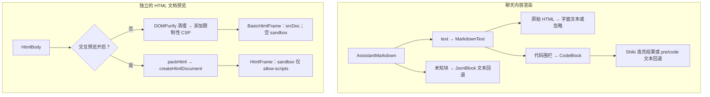

局部异常隔离由 SlotErrorBoundary 和 FactoryErrorBoundary 等机制承担；它们不出现在内容安全转换链中，也不能替代该链。结构化 UI 的建议链为：限制输入体积 → 解析 → Schema 与资源上限校验 → 固定组件和 props 映射 → 局部错误边界 → 失败时纯文本回退。

##### 图 5.2：流式和最终渲染的共享安全规则

下图描述现有 Markdown 渲染路径；严格协议白名单和图片代理是上文建议，并非图中的已实现功能。

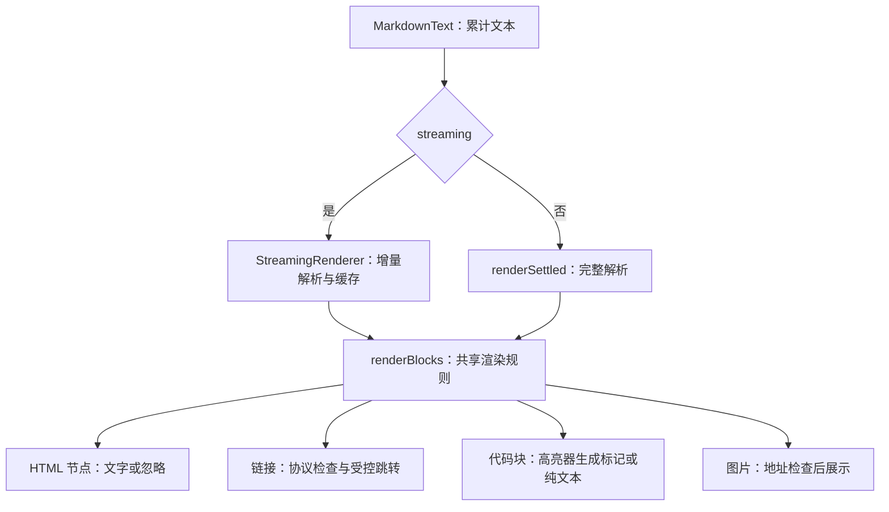

##### 图 5.3：增量排版与完成后的解析

下图是仓库已有的流式与完成渲染路径；分批排版和 Worker 是上述建议，没有画为已实现能力。

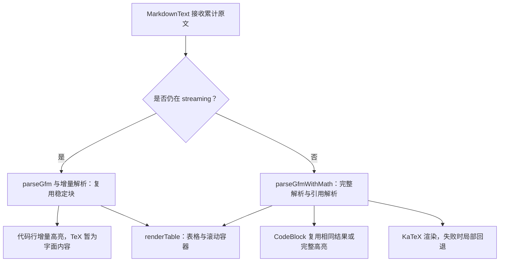

#### 验证记录与实现限制

静态核对了模型块分发、运行时校验示例、错误边界、HTML 预览、流式解析、高亮缓存、表格与公式分支；此前查阅 React、MDN 和 DOMPurify 文档的来源保留在正文。本次未运行浏览器攻击载荷、安全扫描、畸形 Markdown 或长表格／公式性能测试，也未做交互预览整体安全验收。

验收应覆盖跨块攻击输入在每帧的 DOM／网络行为、停止后是否仍触发危险资源、不同拆包的最终解析等价性、公式错误的局部回退及异步排版版本隔离。当前链接策略是危险协议拒绝列表；严格白名单、通用 UI Schema 与运行时资源限额、actionId 以及更强执行隔离仍是建议，不能写成已完成保障。

<a id="topic-6"></a>

### 6. 后台任务进度、幂等与恢复

#### 问题与追问

**问题 6.1：** 让 Agent 在后台执行多步任务时，前端如何呈现进度，又避免重复执行副作用？

**考察点：** 任务状态机、幂等性、重试与恢复。

**追问 6.1：** 用户刷新页面后，怎样恢复正在运行任务的进度？

**回答要点：** 服务端拥有任务，前端按稳定 ID 观察和控制。刷新恢复状态与输出，重试检查任务及操作结果；创建幂等、步骤幂等和外部结果对账共同防止重复副作用。页面重连不代表服务进程重启后可以自动续跑。

#### 状态要表达真实生命周期

建议任务状态包含 queued、running、waiting_confirmation、retrying、stopping、succeeded、failed、cancelled；对可能已经发生副作用但结果不明的步骤，单独显示 outcome_unknown 并暂停自动重试。等待确认时展示具体目标、参数及影响，确认后服务端重新鉴权和检查业务状态。前端展示当前步骤、已完成步骤、等待原因与可执行操作；只有总工作量明确时才显示百分比，模型临时规划的步骤数不能冒充确定总量。

任务完成、订阅连接和日志完整性是三个状态：任务仍在运行时连接可能断开，任务完成时本地还可能没读完输出。点击停止后显示 stopping，等服务端确认结束后再显示终态；取消不是事务回滚。操作结果未知与明确失败也要分开，否则用户会误以为可放心重试。

仓库 [JobView](../packages/jobs/jobs/src/view.ts#L64) 提供 id、owner、status、progress、detail、时间及输出范围；现有本地注册表主要使用 running、stopping、completed、killed、failed，并没有包含上述所有业务状态。[kill](../packages/jobs/jobs-local/src/index.ts#L497) 先调用生产者 cancel，再进入 stopping，最终由生产者结束处理完成状态。这支持“停止请求已接收不等于已停止”的界面表达。

#### 创建幂等、步骤幂等与结果未知的恢复

核心原则是：没有收到成功响应，不代表操作没有成功。前端禁用按钮只能减少重复点击，不能解决网络重发、并发请求或服务崩溃后的重复执行。我会做两层保护：

1. 请求层幂等：同一次用户提交生成稳定的 clientRequestId，网络重发和重试复用它。后端用“用户或租户 + clientRequestId”的唯一约束原子创建任务，并校验请求内容摘要；同一个键提交不同内容要拒绝。已存在的任务返回原任务及状态，而不是重新跑一遍 Agent。明确的新业务意图才生成新键。
2. 工具层幂等：每个已确认的业务动作持久化稳定的 operationId，例如某次退款意图。不能只依赖模型 toolCallId，因为模型重生成时它可能变化；也不能只按参数哈希去重，否则会误合并用户有意发起的两次相同操作。后端以唯一约束和原子状态迁移处理 pending、running、succeeded、failed、unknown；成功则返回已存结果，执行中则查询或等待，结果未知则先对账。
3. 外部副作用：如果下游支持幂等键，所有重试透传同一个 operationId；若操作和执行记录都在本地数据库内，则用事务共同提交。远程调用成功、但本地结果还未写入时发生崩溃，单靠本地去重表无法保证只执行一次。下游不支持幂等时，先按业务单号查询确认；无法确定就暂停自动重试并交由用户或人工核实。

例如退款接口超时，随后生成回复也失败，用户点击重试。恢复时应查询原退款 operationId：已退款就复用退款结果，仅重试后续模型回答；结果未知就查询支付方，不能重新发起一笔退款。模型切换同样必须遵守这个规则。

仓库的 [BatchSettlement](../packages/core/tools/src/batch.ts#L243) 用 callId 关联 tool/call 和 tool/result，提供工具执行记录；这本身不是业务幂等存储。[TOOL_OUTCOME_UNKNOWN 与恢复提示](../packages/core/session/src/repair.ts#L14) 明确区分未开始和已开始但结果未记录，并要求有副作用时先检查外部状态，不能盲目重试。工具的 [timeout-policy](../packages/guard/timeout-policy/src/index.ts#L55) 也等待执行方响应取消后返回，不能由超时推导出外部操作未发生。

因此，我能根据代码确认的是“失败的模型尝试不会直接执行其未完成的工具调用”和“中断工具具有结果未知的恢复语义”；业务级去重表、稳定 operationId 及外部服务幂等键仍需要在具体业务工具中落实，不能声称当前 Harness 已通用保证 exactly-once。

例如“取消订单成功，但写入本地步骤结果前进程崩溃”，重启后不能因为本地没有 succeeded 就再盲目取消。应按订单号与 operationId 查询真实结果，已完成则补记，明确未执行才重试，无法确定则停在待核实状态。[会话修复](../packages/core/session/src/repair.ts#L14) 已区分 TOOL_NOT_STARTED 和 TOOL_OUTCOME_UNKNOWN，后者说明应检查外部状态而不是直接重复副作用；这是一条重要语义依据，但不是已经实现通用订单幂等表。

#### 追问：刷新后恢复同一任务

页面 URL 或受控本地索引保存 taskId／sessionId，刷新后先通过已认证的后端查询有权限访问的任务，再恢复任务状态和输出订阅。标识不是授权凭据，服务端必须检查用户与任务所属关系。记录最后应用的事件序号或输出偏移，重连时续订；如果本地文本已丢失，不能只保存旧游标然后跳过全部历史，应重新请求快照或保留区间。若日志已经淘汰，明确显示缺失，并在有完整日志归档时提供入口。

仓库 [JobListFrame](../packages/api/job-controller/src/types.ts#L20) 使用完整列表替换，重连首帧即可恢复当前可见任务集合。[JobFollowRequest](../packages/api/job-controller/src/types.ts#L50) 接受 jobId、sessionId 和 from，from 是绝对字节偏移，不是字符数；[observeJobOutput](../packages/api/job-controller/src/observe.ts#L41) 先订阅再读取，避免初始读与等待之间漏掉通知，之后使用：

```ts
const read = registry.readAt(id, cursor, request.sessionId)
```

readAt 是不消费模型读取游标的观察接口，输出帧返回 next 和可能的 lossy；任务结束且输出读完后才发 terminal status。前端 [启动观察流](../packages/api/job-controller/src/client/service.ts#L226) 用已观察的偏移重连。这些能力支持页面重连后的进度恢复，不能改用会推进模型游标、仅交付一次结果的 read 接口来做 UI 轮询。

#### 页面刷新恢复不等于服务端重启恢复

本地 [JobRegistry.store](../packages/jobs/jobs-local/src/index.ts#L170) 是 Map。注册和结束会写会话事件，见 [append lifecycle event](../packages/jobs/jobs-local/src/index.ts#L458)，但事件存在不代表运行中的生产者、输出环形缓冲和任意外部操作都可在新进程重新接管。因此我会把承诺限定为：服务端任务仍存活且保留数据可读时，前端重新观察它；不能宣称当前实现已经具有持久化工作流引擎的重启续跑能力。

若产品要求跨服务端重启继续任务，需要额外持久化步骤输入、结果、幂等记录和检查点；任务领取使用租约／心跳与所有权校验，旧 worker 失去所有权后不能继续提交结果，外部副作用仍由业务幂等兜底。恢复时先核实未确定步骤，再决定续跑位置，不能从第一步重新执行整个 Agent。这是建议扩展，不是本轮要修改的产品代码。

#### 设计依据与取舍

| 问题或约束 | 设计选择 | 原因与限制 |
| --- | --- | --- |
| 页面生命周期短于任务 | 服务端拥有任务，前端按 ID 观察 | 刷新不能触发第二次创建 |
| 输出、连接与任务完成时机不同 | 分别记录状态，终态前排空输出 | 避免“断线即失败”或“收到停止回执即结束” |
| 副作用成功但响应丢失 | 持久化 operationId、查询与对账 | 请求重试不等于业务可以再次执行 |
| 注册表存于进程内 | 区分前端重连与服务重启续跑 | 后者还需要持久化调度和检查点 |

#### 涉及代码与职责

| 代码入口 | 输入与输出 | 职责与限制 |
| --- | --- | --- |
| [JobView](../packages/jobs/jobs/src/view.ts#L64) | 任务投影 → 进度和输出范围 | 前端展示的真实状态字段 |
| [JobRegistry.store / start](../packages/jobs/jobs-local/src/index.ts#L170) | 任务启动 → 进程内记录 | 不能当作持久化工作流引擎 |
| [JobRegistry.kill](../packages/jobs/jobs-local/src/index.ts#L497) | 停止请求 → stopping | 停止与结算分离 |
| [JobFollowRequest / JobFollowFrame](../packages/api/job-controller/src/types.ts#L50) | 字节偏移 → 输出和终态 | next、lossy 与重连续读 |
| [observeJobOutput](../packages/api/job-controller/src/observe.ts#L41) | jobId 和调用会话 → 观察事件 | 先订阅再读，readAt 不消费模型游标 |
| [会话修复语义](../packages/core/session/src/repair.ts#L14) | 未完成工具记录 → 明确恢复说明 | 未开始与结果未知必须分开 |

#### 流程图

##### 图 6.1：现有任务列表、偏移续读和终态

下图为现有后台任务观察路径；持久化步骤幂等和跨进程恢复是上文的建议设计。

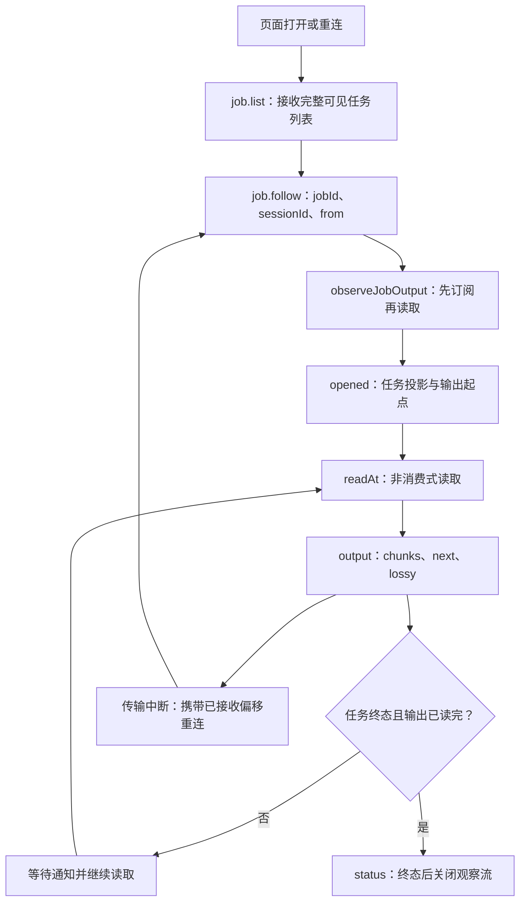

#### 验证记录与实现限制

本题静态核对了任务投影、进程内 Map、生命周期事件、取消和输出观察协议；未运行刷新、进程崩溃、重复执行或对账测试。当前可确认的是非消费式观察、偏移续读和保留区间缺失标记；持久化业务幂等与跨服务端重启继续执行仍属于建议。

<a id="topic-7"></a>

### 7. AI 前端改版的体验评估与实验设计

#### 问题与追问

**问题 7.1：** 怎么评估一次 AI 前端功能改版是否真的改善了用户体验？

**考察点：** 产品指标、质量指标、实验设计。

**追问 7.1：** 如果延迟下降但用户重试率上升，你会怎样判断改版效果？

**回答要点：** 我会先确定改版要改善的具体用户任务和可验证假设，再把任务完成作为主要结果，用质量、可靠性、延迟、交互流畅度和成本共同约束。先在可重复用例上排除明显退化，再以稳定分组的小流量实验验证。首 token 更快只能说明一个阶段变快，不能单独证明用户更容易完成任务。

#### 先定义成功，再定义指标的分母和时间起点

例如知识问答的成功，可以是答案正确且足以解决问题、关键结论有支持来源；订单操作的成功，应以服务端确认目标业务状态为准；写作助手则需要用户确认采用或人工评估有用性。复制、点赞、停留时长和发送次数只能作为辅助信号，不能自动等同任务完成，也不能把回答更长作为质量提升。

| 维度 | 建议指标与口径 | 解释时的限制 |
| --- | --- | --- |
| 任务结果 | 规定观察窗口内完成目标的逻辑任务数／符合条件的任务数；首次尝试完成率 | 多次重试仍属于同一任务；未确定结果单列，不能只统计成功收到响应的请求 |
| 答案质量 | 正确性、完整性、上下文忠实度、引用支持率、合适拒答率 | 按任务类型评分；模型打分需人工校准，不能用文本长度替代 |
| 感知延迟 | 用户提交到首个有用内容可见、到答案可用、到任务终态的时长及 P50／P95 | 首个字节、心跳、隐藏推理和工具参数不等于用户看到答案 |
| 稳定性 | 错误率、超时率、流中断率、恢复成功率、工具结果未知比例 | 区分网络观察失败与任务执行失败，记录重试放大 |
| 操作体验 | 用户主动重试、修改、取消、继续追问、采用结果及反馈原因 | 取消可能表示已经得到答案；追问可能是探索，不能一概算失败 |
| 前端流畅度 | 文本到达至可见的间隔、提交耗时、长任务、输入响应、滚动跳动 | 服务端更快不代表解析和绘制更快；按设备与文本长度分层 |
| 成本与风险 | 每个成功逻辑任务的调用／token／费用、重复副作用、越权或数据泄露 | 不能用更多昂贵重试换取表面成功率，也不能容忍高风险退化 |

客户端用同一时间基准测从提交到可见的耗时，记录 UI 版本、实验分组、taskId／messageId／attemptId 和关键事件；服务端记录排队、模型与工具阶段，使用关联 ID 联结。不能直接相减未校准的两台机器时间。前端埋点也应区分“数据到达”“React 提交”和“有用内容已进入可见展示”的操作性定义；一次 requestAnimationFrame 回调并不自动证明像素已被用户看到，应用统一的测量方法并用性能轨迹抽样核对。

#### 仓库已有统计可以复用，但要读清口径

仓库 [SessionStatsProjection](../packages/session/session-stats/src/types.ts#L24) 包含 llmMs、toolMs、ttftMs、ttftSteps、decodeMs 和 decodeTokens。[统计投影](../packages/session/session-stats/src/projection.ts#L125) 从 step/start、assistant/attempt、assistant/message 与 tool/call／tool/result 聚合数据；工具耗时按 callId 配对。它能提供模型与工具时序的基础，但没有直接证明已经采集用户首字可见、浏览器输入延迟、任务采纳或 A/B 分组。

有三点会直接影响结论。第一，[isTokenDelta](../packages/llm/llm/src/assistant-stream.ts#L249) 和 [assistantStreamFirstTokenTime](../packages/llm/llm/src/assistant-stream.ts#L332) 使用非空文本、推理或工具调用增量判断首 token；它不是严格的“用户首个答案文字”。第二，现有 [projection 的时间聚合](../packages/session/session-stats/src/projection.ts#L138) 在 assembled assistant/message 到来时累计模型时间和首 token 时间；取消且没有组装消息的步骤虽然计入 step 数，部分流时间不会进入这些耗时汇总，不能用这些汇总直接代表全部用户尝试。第三，累计和与计数可以算相应口径的均值，不能还原 P95；需要保留合适的逐任务样本或分布统计。

上述统计里的首 token 还能延续同一步内较早尝试的首增量，这有利于保留步骤时序，但不同于“最终成功 attempt 的首字等待”。做实验前必须固定口径、明确是否包含重试和失败，否则通过更早输出无用内容、提早失败或增加取消，也可能让某个平均耗时看起来变好。

用户反馈可以复用 [MessageFeedbackController.putCommitted](../packages/client/ui-message-feedback/src/client/controller.ts#L190) 的 sessionId、messageId、rating、note、category 和版本条件，再在受控记录中关联当时的 UI／模型／提示／检索版本。反馈只覆盖愿意反馈的用户，需结合真实任务结果和抽样访谈；日志遵守最小化原则，默认不收集完整敏感问题和内部文档。

#### 降级专项指标：原始目标与替代结果分开计数

在上述全链路指标之外，用 taskId／attemptId／operationId 关联逻辑任务和物理调用，按模型、工具及错误类别统计重试次数、等待时间、切换原因与费用，识别请求放大。

降级触发率可以定义为进入降级的逻辑任务数／符合该策略范围的任务数；降级成功率为达到降级后约定结果的任务数／触发降级的任务数，同时报告是否完成原始目标。展示基础搜索结果成功，不等于原本要求的自动订单操作成功。还应比较启用策略前后或受控分组的端到端成功率、P95 等待时间、用户继续操作率和成本；只看“备用模型返回了 200”无法证明体验改善。以上指标设计不能用仓库存在重试事件来冒充已有完整监控看板。

#### 先离线回归，再小流量验证

离线分两类：用固定事件流回放检查同样文本在新旧前端的正确性、性能与可访问性；用固定真实问题集评估整个 AI 功能的答案与任务结果。覆盖长文本、慢速与突发输出、中断恢复、快速取消、历史编辑、表格／代码／公式、无答案、工具失败和移动端等场景。前端纯展示改版应尽量使用相同模型输出，避免模型随机性掩盖界面差异；若同时改模型或提示，则明确把它们列为实验因素。性能用代表性设备、同等条件下的多次运行观察分布，不能把单次截图或一次计时作为收益证明。

线上预先约定主要指标、质量与风险保护指标、分组单位、最小有意义改变量、样本量和观察窗口。按用户或工作区稳定分组，避免同一对话来回切换版本；若存在团队共享工作流，分组和统计应考虑团队内关联。记录实际曝光，核对样本比例和事件丢失，保持除待测因素以外的模型、提示、检索和路由策略尽量一致；必须同时变化时保留版本，避免将模型升级收益误归给前端。

先小流量看异常，触及可靠性、质量或副作用风险阈值时回退。正常扩量按预先约定的统计方法和业务收益判断，不能每天看一眼显著就随时宣布成功。按问题类型、设备、网络、长短文本和新老用户分层，同时查看总体与样本量；某一层样本不足时保留不确定性，不因小样本波动贸然定论。分层和主要指标应尽量预先指定，减少事后挑选好看结果。

#### 追问：延迟下降但重试率上升

我不会直接认定改版成功，也不会只凭重试上涨立即认定失败。先确认“重试”是否指用户针对同一任务主动再生成，还是自动网络恢复、服务端 retry、重复埋点或新问题；检查按钮位置是否更显眼、埋点是否改变、任务类型和用户构成是否变化。实验分析以最初分配的合格任务为主要对象，并记录实际曝光，避免只选完整收到回答的幸存样本。

接着关联同一任务的多次尝试，比较首次完成率、最终完成率、到真正完成任务的总耗时、答案质量和每个成功任务成本。单次首字等待下降，但用户要多试几次才得到有用答案，端到端完成反而更慢，这通常是退化。检查是否为了更快而提前截断、少检索、降低模型能力、过早显示未成熟答案，或 UI 让用户误以为生成已经停止。对新增重试样本按原因做人工抽查，查看重试前后的具体内容和状态。

反过来，如果改版让“尝试另一个写作版本”更容易，重试增加但用户采用率、任务完成率和主观满意度提高，总成本与风险仍在预算内，那么它可能是有价值的探索行为。需要通过任务分类、反馈和行为序列验证，而不是用这个解释掩盖所有重试。若主要指标或质量保护指标退化，则回退或缩小改版范围；若收益与损失都不确定，则继续按预设方案收集证据，不仅凭延迟下降扩量。

#### 设计依据与取舍

| 问题或约束 | 设计选择 | 原因与限制 |
| --- | --- | --- |
| 系统输出快不代表任务完成快 | 主要看逻辑任务完成与总耗时 | 首 token 是过程指标，不能替代业务结果 |
| 现有统计排除了部分取消流 | 同时报全体任务的结局和分布 | 避免幸存样本造成虚假加速 |
| 用户重试含义不唯一 | 区分失败重试、恢复和主动探索 | 结合质量、采用和成本，而非单独定好坏 |
| 模型随机性和人群变化干扰比较 | 固定回放、稳定分组、版本记录、分层分析 | 同时报告不确定性，避免只挑好看的指标 |

#### 涉及代码与职责

| 代码入口 | 输入与输出 | 职责与限制 |
| --- | --- | --- |
| [SessionStatsProjection](../packages/session/session-stats/src/types.ts#L24) | 持久日志聚合 → 次数和耗时累计值 | 已有模型／工具基础指标，不能直接得出 P95 |
| [sessionStats projection](../packages/session/session-stats/src/projection.ts#L125) | 步骤、消息、工具事件 → 统计状态 | 完成消息才累计部分时间，取消流需要另看 |
| [isTokenDelta](../packages/llm/llm/src/assistant-stream.ts#L249) | 流式 chunk → 首 token 判断 | 推理／工具增量不等同答案已可见 |
| [Notifier / 当前流发布](../packages/api/session-controller/src/client/sessions/session.ts#L803) | 消息增量 → UI 通知 | 前端调度延迟需另测，不能用服务端耗时代替 |
| [MessageFeedbackController](../packages/client/ui-message-feedback/src/client/controller.ts#L190) | 消息评价 → 版本化保存 | 可关联质量反馈，实验归因字段仍需设计 |

#### 流程图

##### 图 7.1：现有统计反馈与建议的实验流程

现有代码提供事件统计和消息反馈；实验分组、前端可见性埋点与业务结果评测为建议新增流程。

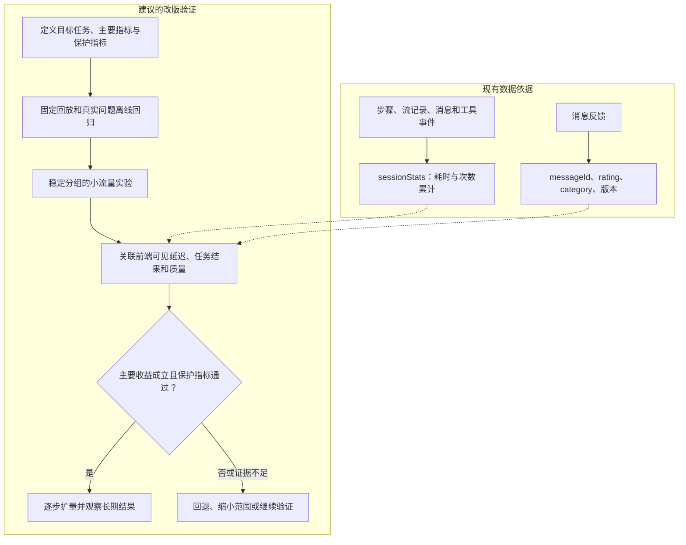

#### 验证记录与实现限制

本题静态检查现有统计口径、首 token 判定和反馈保存；未进行性能基准、用户实验或质量评测，因此不声称任何改版已带来收益。A/B 分组、首个有用内容可见埋点、业务完成判定和统计分析方案属于建议。
